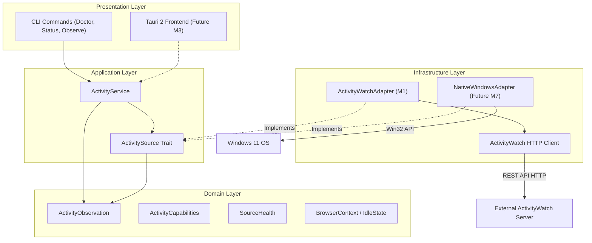

# FlowGuard Architecture

## 1. High-Level Architecture Overview

FlowGuard is structured around clean architecture principles and hexagonal design (ports and adapters). The core domain and application layers have zero dependencies on external services, native Windows handles, or provider-specific communication protocols.



---

## 2. Activity Source Abstraction (`application/ports.rs`)

The `ActivitySource` trait is the core architectural boundary of the entire activity monitoring subsystem:

```rust
pub trait ActivitySource: Send {
    fn connect(&mut self) -> Result<SourceCapabilities, SourceError>;
    fn poll(&mut self) -> Result<ActivityObservation, SourceError>;
    fn health(&self) -> SourceHealth;
}
```

### Architectural Guarantees:
1. **Zero Provider Leaks**: No ActivityWatch bucket IDs, REST routes, HTTP response codes, or ActivityWatch event types ever exist in the domain model.
2. **Synchronous Simplicity**: `poll()` executes synchronously during each tick, eliminating unnecessary async runtime complexity and thread churn.
3. **Pluggable Providers**: The active provider is chosen at initialization based on `config.activity_source.provider`.

---

## 3. How Normalized Activity Flows Through the System

1. **Poll Request**: `ActivityService` invokes `source.poll()` on the active adapter.
2. **External Retrieval**: `ActivityWatchAdapter` queries the latest single event from each discovered bucket (`currentwindow`, `afkstatus`, `web.tab.current`).
3. **Freshness Evaluation**: The adapter calculates the effective timestamp (`timestamp + duration`) for each event against the current UTC clock. If age > `stale_after_secs`, the event is classified as `Stale`.
4. **Domain Normalization**: Raw JSON payloads are mapped into `ActivityObservation`. Stale or missing data is safely marked (`application: None`, `idle_state: Unknown`, `browser: None`) rather than fabricating activity.
5. **Change Detection**: The `ActivityService` compares the new observation with the previous observation using `has_meaningful_change()`.
6. **Delivery**: Downstream consumers (CLI stream, workflow engine, intervention alerts) only receive meaningful, verified, fresh state transitions.

---

## 4. How `NativeWindowsAdapter` Will Replace `ActivityWatchAdapter`

In Milestone 7, FlowGuard will introduce its own native Rust monitoring implementation.

```text
Existing Milestone 1:
ActivityWatch Server (Python/Rust) ---> REST API (127.0.0.1:5600) ---> ActivityWatchAdapter ---> ActivitySource ---> Domain

Future Milestone 7:
Windows Native APIs (Win32 / UI Automation) ------------------------> NativeWindowsAdapter  ---> ActivitySource ---> Domain
```

### Transition Blueprint:
1. `NativeWindowsAdapter` will implement the exact same `ActivitySource` trait.
2. Direct Win32 API calls will replace REST queries:
   - `GetForegroundWindow` + `GetWindowTextW` for window titles.
   - `GetWindowThreadProcessId` + `QueryFullProcessImageNameW` for application executables.
   - `GetLastInputInfo` for user idle duration (AFK detection).
   - UI Automation / Accessibility tree traversal for active browser tab URLs.
3. The adapter will return identical `ActivityObservation` instances.
4. In `flowguard.toml`, switching:
   ```toml
   [activity_source]
   provider = "native_windows"
   ```
   switches the engine without modifying a single line of code in the workflow engine, intervention engine, analytics, or UI.
