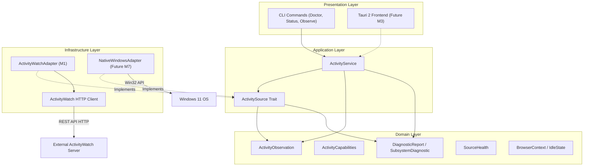

# FlowGuard Architecture

## 1. High-Level Architecture Overview

FlowGuard is structured around clean architecture principles and hexagonal design (ports and adapters). The core domain and application layers have zero dependencies on external services, native Windows handles, or provider-specific communication protocols.



---

## 2. Activity Source Abstraction (`application/ports.rs`)

The `ActivitySource` trait is the core architectural boundary of the entire activity monitoring subsystem:

```rust
pub trait ActivitySource: Send {
    fn connect(&mut self) -> Result<SourceCapabilities, SourceError>;
    fn poll(&mut self) -> Result<ActivityObservation, SourceError>;
    fn health(&self) -> SourceHealth;
    fn diagnose(&mut self) -> Result<DiagnosticReport, SourceError>;
}
```

### Architectural Guarantees:
1. **Zero Provider Leaks**: No ActivityWatch bucket IDs, REST routes, HTTP response codes, or ActivityWatch event types ever exist in the domain model or application service.
2. **Synchronous Simplicity**: `poll()` executes synchronously during each tick, eliminating unnecessary async runtime complexity and thread churn.
3. **Pluggable Providers**: The active provider is chosen at initialization based on `config.activity_source.provider`.
4. **Provider-Neutral Diagnostics**: `ActivitySource::diagnose()` returns a structured `DiagnosticReport` containing `SubsystemDiagnostic` items. The application `ActivityService::run_doctor()` delegates directly to `source.diagnose()`, with zero knowledge of HTTP or ActivityWatch internals.

---

## 3. Decoupling Capabilities from Freshness (M1.1)

In early iterations, capabilities were derived from transient event freshness (e.g. if a browser event was older than 15s, `capabilities.browser_url_tracking` was flipped to `false`).

This violated architectural invariants:
- **Capabilities** (`ActivityCapabilities`) are **structural invariants**: they represent what the activity source is configured and confirmed capable of observing during bucket discovery or hardware hook initialization.
- **Freshness** (`FreshnessState`) is **transient observation state**: it reflects whether the user is currently generating events on that channel.
- If a user switches from Chrome to a native terminal, the browser watcher bucket becomes quiescent. The source does **not** lose the ability to track browser URLs; the observation simply reflects `browser_freshness: Stale` while `capabilities.browser_url_tracking: true` remains active.

---

## 4. How Normalized Activity Flows Through the System

1. **Poll Request**: `ActivityService` invokes `source.poll()` on the active adapter.
2. **External Retrieval**: `ActivityWatchAdapter` queries the latest single event from each discovered bucket (`currentwindow`, `afkstatus`, `web.tab.current`).
3. **Transport Error Differentiation**:
   - Connection Refused: triggers immediate `SourceHealth::Disconnected`.
   - Timeout: marks channel observation as `Stale` (unreliable) and records transport latency diagnostic (not "empty bucket").
   - 404 Missing Bucket: records bucket not found diagnostic.
   - Empty `[]`: records no recorded events yet.
4. **Freshness Evaluation**:
   - For Window & Web events: The adapter calculates the effective timestamp (`timestamp + duration`) against the current UTC clock. If age > `stale_after_secs`, the event is classified as `Stale`.
   - For AFK events (`check_afk_freshness`):
     - When `status == "not-afk"`: Heartbeats pause while reading/thinking. Freshness threshold is `afk_timeout_secs + stale_after_secs` (e.g. 180s + 15s = 195s).
     - When `status == "afk"`: Heartbeats pulse periodically (every ~5s) extending `duration`. Freshness threshold is `stale_after_secs` (15s).
5. **Domain Normalization & Separation of Concerns**:
   - **Idle State** (`IdleState::Active`, `IdleState::Afk`, `IdleState::Unknown`): Normal user activity state. An AFK user is a valid, normal state.
   - **Observation Freshness** (`FreshnessState::Fresh`, `FreshnessState::Stale`, `FreshnessState::Missing`): Temporal validity of watcher events.
   - **Source Health** (`SourceHealth::Connected`, `SourceHealth::Degraded`, `SourceHealth::Disconnected`, `SourceHealth::WrongService`): Operational status of the integration.
     - Fully healthy (`Connected`) when essential desktop window and AFK watcher data are both `Fresh`.
     - User being AFK NEVER degrades source health.
     - Optional browser extension inactivity NEVER degrades desktop monitoring health.
6. **Change Detection**: The `ActivityService` compares the new observation with the previous observation using `has_meaningful_change()`.
7. **Delivery**: Downstream consumers (CLI stream, workflow engine, intervention alerts) only receive meaningful, verified, fresh state transitions.

---

## 5. How `NativeWindowsAdapter` Will Implement `diagnose()` Without HTTP

In Milestone 7, FlowGuard will introduce its own native Rust monitoring implementation (`NativeWindowsAdapter`).

```text
Milestone 1:
ActivityWatch Server (Python/Rust) ---> REST API (127.0.0.1:5600) ---> ActivityWatchAdapter ---> ActivitySource ---> Domain

Milestone 7:
Windows Native APIs (Win32 / UI Automation) ------------------------> NativeWindowsAdapter  ---> ActivitySource ---> Domain
```

Because `DiagnosticReport` and `SubsystemDiagnostic` are completely provider-neutral:
1. `NativeWindowsAdapter::diagnose(&mut self)` will return:
   - `provider_name`: `"NativeWindows"`
   - `endpoint`: `"Win32 Subsystem / WinEventHook"`
   - `is_reachable`: `true` (if Windows OS API responds)
   - `subsystems`:
     * Subsystem `"Active Window"` (target: `"SetWinEventHook / GetForegroundWindow"`): checks whether hook is registered and window handles can be queried.
     * Subsystem `"User Idle / AFK"` (target: `"GetLastInputInfo"`): checks whether idle tick counter is responding.
     * Subsystem `"Browser Accessibility"` (target: `"IUIAutomation / Accessibility Tree"`): checks UI Automation COM initialization and accessibility permissions.
2. Zero HTTP concepts, REST endpoints, or JSON serialization errors are exposed to the presentation layer or doctor command.
