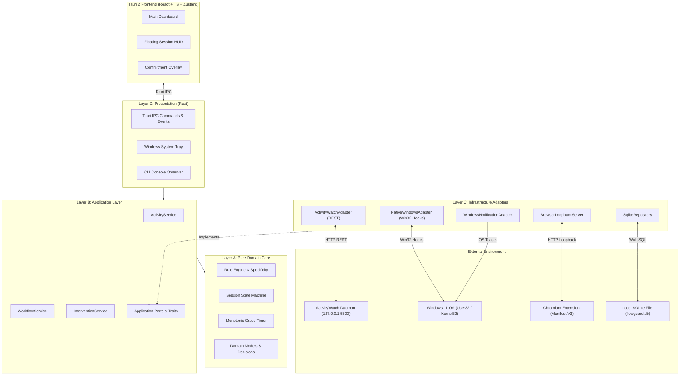
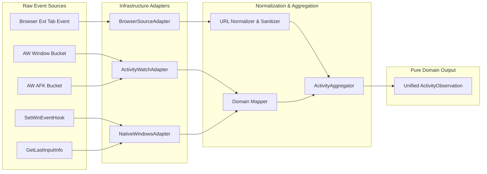
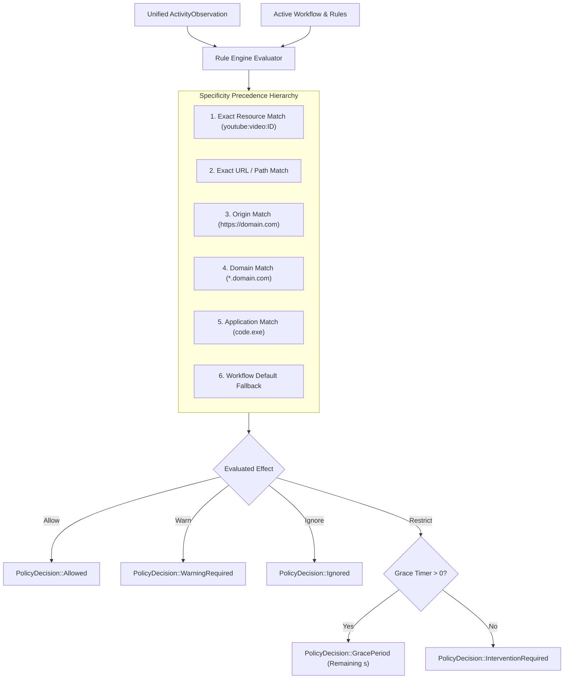
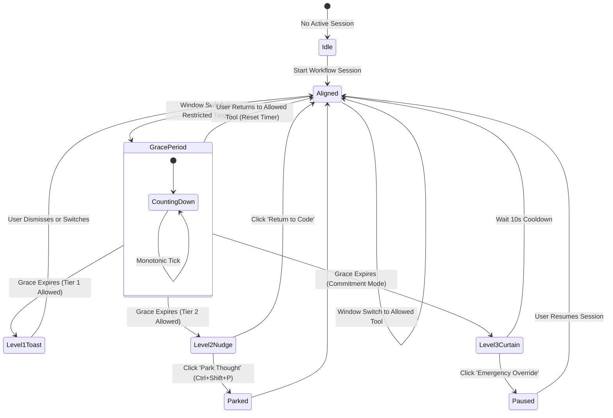
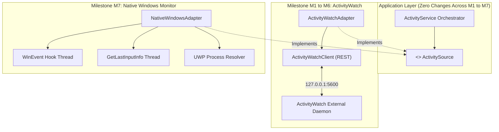
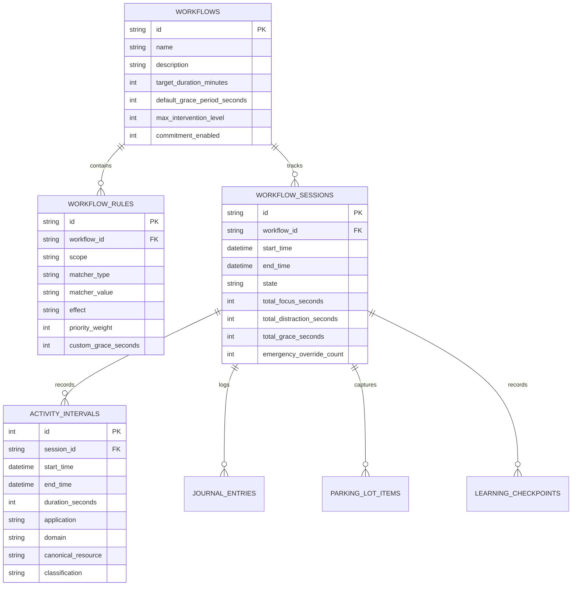

# FlowGuard: Master Product Vision, Feature Specification & Software Architecture Blueprint

**Document Version:** 1.0.0-PROPOSAL  
**Status:** Approved Architecture Baseline for Engineering Review  
**Lead Architect:** Principal Software Architect & Technical Product Designer  
**Target Platform:** Windows 11 (Initial), Modular Local-First Core  
**Core Language:** Rust 2021 Edition  
**Desktop Framework:** Tauri 2 (Rust Core + Webview Presentation)  
**Frontend Stack:** React 18+, TypeScript, Tailwind CSS, shadcn/ui, Zustand  
**Local Persistence:** SQLite (WAL mode, Foreign Keys Enabled)  
**Initial Activity Provider:** ActivityWatch Local REST API (v0.14+)  
**Future Activity Provider:** FlowGuard Native Windows Monitor (Win32 Hooks)  
**Browser Extension:** Chromium Manifest V3 (Minimal Local Loopback)  

---

# Section 1: Executive Summary & Objective

This document defines the authoritative, end-to-end product vision, functional specification, and software architecture for **FlowGuard**—a local-first, context-aware productivity and intention-guarding system for knowledge workers, software engineers, and researchers.

FlowGuard bridges the critical gap between passive time trackers (which record what happened without guarding intention) and blunt website blockers (which rely on rigid domain blacklists, break legitimate multitasking, and provoke user resentment). Modern intellectual work is inherently non-linear: a software developer switches constantly between an IDE, terminal, API documentation, local dev servers, and specific technical video explanations. A traditional blocker treats `youtube.com` as either wholly forbidden or wholly allowed. FlowGuard recognizes the specific resource in context—allowing a 15-minute tutorial on algorithmic dynamic programming while preventing drift into algorithmic recommendation rabbit holes.

### Purpose of this Specification
1. **Definitive Architectural Baseline:** Establish the modular, port-and-adapter (Hexagonal / Clean) architecture that allows zero-downtime evolution across milestones M1 through M7.
2. **Component Boundaries & Contracts:** Explicitly decouple domain rules, workflow policies, and persistence from ephemeral infrastructure details (such as whether activity data originates from ActivityWatch or native Win32 hooks).
3. **Execution Guardrails:** Eliminate architectural drift, premature optimization, and hidden dependencies before code implementation begins.
4. **Educational Engineering Reference:** Provide deep conceptual bridges and maintainability guidelines for engineers expanding their systems programming expertise in Rust.

---

# Section 2: Problem Statement & Core Product Philosophy

## 2.1 The Problem FlowGuard Solves

Modern computer-based intellectual work is plagued by **unintended intention drift** and **activation resistance**.

### The Activation Dilemma: The Need for an External Commitment Anchor
Often, the hardest part of productive intellectual work is simply *starting and staying hooked* when motivation is low. A user knows they must study a difficult subject (e.g., advanced systems programming, thesis literature, or algorithmic problem-solving), but their intrinsic willpower is depleted. In that moment of resistance, the urge to evade the discomfort of hard intellectual work by opening social media, video feeds, or instant messaging is overwhelming.

FlowGuard acts as an **External Cognitive Anchor**. When the user recognizes their resistance, they activate FlowGuard. The system immediately assumes the role of an unwavering, objective focus partner:
- It locks the user into their chosen productive ecosystem.
- It removes the continuous, exhausting tax of moment-to-moment willpower.
- It guarantees that even if their mind wanders, the environment pulls them right back.
- The user can work with complete psychological peace of mind, confident that FlowGuard will prevent drift from turning into a lost afternoon. Knowledge workers sit down with a specific, high-value goal (e.g., "Solve LeetCode #42 in Rust" or "Draft Thesis Chapter 3"), but experience repeated friction:
1. **The Blunt Blocker Dilemma:** Traditional blockers operate at the DNS, hosts file, or domain level. When a developer needs to look up a bug on Reddit or watch a specific framework lecture on YouTube, they must disable the blocker entirely. Once unblocked, the floodgates open, and focus is lost.
2. **The Passive Tracker Dilemma:** Tools like RescueTime or raw ActivityWatch accurately record that a user spent 4 hours in a browser, but offer zero real-time guidance when the user drifts from documentation to social media.
3. **The Shame and Hostility Dynamic:** Many productivity apps use coercive patterns: locking the computer screen without an escape hatch, insulting the user, or reporting metrics to external servers. This produces adversarial behavior: users uninstall the application, bypass rules via secondary devices, or develop tool fatigue.
4. **Context Blindness:** In modern workflows, switching between windows is not distraction—it is the work itself. An engineer writing a full-stack feature must cycle between VS Code, PowerShell, pgAdmin, and Chrome (`localhost:3000`). Tools that measure "focus" purely by application dwell time misclassify normal engineering collaboration as ADHD-like distraction.

## 2.2 Core Product Philosophy

FlowGuard is built on six immutable design principles:

### Principle 1: Understand the Workflow, Not Just the Application
An application is neither virtuous nor distracting in isolation. `chrome.exe` can host an academic paper on arXiv or an endless video feed. `code.exe` can be used to write high-impact systems code or tweak editor themes for three hours. FlowGuard evaluates activity **in the context of an active Workflow**. A workflow establishes the user's explicit intention, defining which applications, domains, and specific resources are aligned with that intention.

### Principle 2: Do Not Mistake Inactivity for Distraction
Thinking is the core activity of software engineering and research. When an engineer stares at a terminal for 180 seconds or sketches an entity-relationship diagram on physical paper while their monitor remains idle, they are not distracted. FlowGuard treats `AFK` / `Idle` states as **cognitive pauses or physical disengagement**, never as policy violations or time spent "slacking." Grace timers and intervention policies pause during genuine AFK.

### Principle 3: Do Not Punish Legitimate Application Switching
High-performance knowledge work requires rapid, fluid context shifting. An engineer writing a backend service might execute:
`VS Code` (40s) -> `Terminal` (10s) -> `Chrome [Local Docs]` (30s) -> `VS Code` (60s).
FlowGuard never fires warnings or consumes grace periods during transitions between applications that both belong to the active workflow's allowed set. Transitions between allowed tools carry zero penalty.

### Principle 4: Intervene Selectively & Proportionally
Interventions must be surgical, progressive, and respect user focus. A brief accidental click into an email client should not immediately hijack the screen. FlowGuard employs:
- **Configurable Grace Periods:** Give the user an opportunity to self-correct before any prompt appears.
- **Hysteresis & Debouncing:** Suppress false alarms caused by rapid window cycling (e.g., cycling through Alt+Tab).
- **Tiered Escalation:** Progress from silent observation to gentle ambient cues, active nudges, and only entering full-screen commitment overlays when explicitly configured by the user.

### Principle 5: User Autonomy & Anti-Coercive Ethics
FlowGuard is a **cognitive prosthetic**, not a prison warden or corporate surveillance tool.
- The user is always in control.
- Emergency overrides must always exist.
- FlowGuard will never terminate user processes (`taskkill`), hijack OS mouse focus, disable network adapters, or display degrading, judgmental messages.
- The tone of all notifications is calm, factual, and neutral: *"You are currently visiting twitter.com, which is outside 'Thesis Research'. Return to workflow or snooze?"*

### Principle 6: Local-First Privacy & Zero Telemetry
Productivity data represents the most intimate record of a human being's thoughts, intellectual struggles, and daily habits.
- **100% Local Execution:** FlowGuard runs entirely on the user's machine.
- **Zero Telemetry:** No cloud analytics, no remote pings, no account creation, no external server calls.
- **Data Minimization:** FlowGuard stores only aggregated session summaries and anonymized resource identifiers. Raw keystrokes, clipboard contents, screen captures, and full browsing histories are never collected or stored.

---

# Section 3: Complete Feature Vision & Real-World Workflows

## 3.1 Workflow Management & Lifecycle

Workflows are the fundamental unit of intention in FlowGuard. A workflow encapsulates a goal, an optional time budget, a set of policy rules, and escalation preferences.

### Workflow Metadata & Configuration
Each workflow definition contains:
- **Identifier:** UUIDv4 (`workflow_id`).
- **Name:** Human-readable title (e.g., "Competitive Programming Practice").
- **Description & Intent:** Short summary of the objective (e.g., "Solve 2 LeetCode Medium problems in Rust without looking at solutions").
- **Category:** Tagging taxonomy (`SoftwareEngineering`, `Learning`, `DeepWriting`, `SystemAdministration`, `General`).
- **Allowed Applications:** Set of executable identifiers (`code.exe`, `windowsterminal.exe`).
- **Allowed Web Origins / Domains:** Explicit website boundaries (`leetcode.com`, `doc.rust-lang.org`).
- **Allowed Specific Resources:** Fine-grained resource locks (e.g., YouTube video ID `youtube:video:bMknfKXIFA8`).
- **Restricted Targets:** Explicit blacklists overriding broader allowances.
- **Rule Hierarchy & Specificity Overrides:** Precedence mappings.
- **Grace Period Configuration:** Default buffer (e.g., 15 seconds) before non-workflow activity triggers escalation.
- **Intervention Tier Settings:** Maximum allowable intervention level (Level 0 through Level 3).
- **Commitment Contract:** 
  * `AccountableBreakable`: The user may end the session early only by providing an explicit, written explanation (*"Why are you abandoning this workflow early?"*), which is permanently logged for self-improvement analytics.
  * `Unbreakable (Ulysses Contract)`: The user binds themselves unconditionally. Once started, the workflow *cannot be ended, cancelled, or broken under any circumstance* until the planned time budget runs out.
- **Commitment Mode Settings:** Strictness level (`Soft`, `Firm`, `Hardcore`), emergency cooldown duration, and mandatory override reason logging.
- **Break Policy:** Micro-break interval (e.g., 5-minute break every 50 minutes of active aligned focus).
- **Session Planned Duration:** Optional target session length (e.g., 90 minutes).

### Explicit Workflow Lifecycle State Machine
A workflow session exists in exactly one of the following states:

```
  +---------+
  |  Draft  |
  +----+----+
       | validate()
       v
  +----+----+        start()
  |  Ready  +-----------------------+
  +----+----+                       |
       ^                            v
       | reset()              +-----+----+    pause()    +--------+
       +----------------------+  Active  +-------------->+ Paused |
                              +--+--+----+<--------------+---+----+
                                 |  |         resume()       |
                       complete()|  |                        |
                                 |  +------+                 |
                                 v         | interrupt()     v
                           +-----+-----+   |           +-----+-----+
                           | Completed |   +---------->+Interrupted|
                           +-----------+   crash/sleep +-----------+
```

1. **Draft:** Workflow is being authored or modified. Rules are unvalidated. Cannot be started.
2. **Ready:** Workflow is saved, fully validated, and available in the user's library.
3. **Active:** An active session is currently running. Real-time observations are actively evaluated against rules. Grace timers and focus accumulators are running.
4. **Paused:** The user explicitly stepped away or initiated an intentional pause. Activity monitoring continues in passive background mode, but policy evaluation and grace timers are suspended. Time spent here is categorized as `PausedTime`.
5. **Completed:** The session concluded naturally (time budget elapsed or user selected "Complete Goal"). Final metrics are computed and sealed in SQLite.
6. **Cancelled:** The user terminated the session early without intending to preserve completion credit.
7. **Interrupted:** The session was unexpectedly broken by system shutdown, laptop sleep exceeding 30 minutes, or application crash. Upon reboot, FlowGuard detects the unsealed session and initiates the recovery flow.

## 3.2 Multiple Applications Per Workflow
FlowGuard fundamentally rejects single-app locking. Real workflows require multi-tool ecosystems:
- An allowed set can contain 1 to N executables.
- Switching between `code.exe` and `windowsterminal.exe` consumes 0 seconds of grace period.
- Background helper processes (e.g., `git.exe`, `rust-analyzer.exe`, `cargo.exe`) spawned by allowed parents are automatically recognized as legitimate supporting activity.

## 3.3 Website & Origin Rules
Web activity is categorized along three distinct structural boundaries:
1. **Origin / Domain Matching:** Allows an entire site (e.g., `https://doc.rust-lang.org/*` or `https://github.com/*`).
2. **Path & Subdirectory Matching:** Restricts access to specific sections of a domain (e.g., allowing `https://reddit.com/r/rust/*` while restricting `https://reddit.com/r/all/*`).
3. **Resource-Level Locking:** Restricts access down to an exact media item or document ID, completely decoupling the platform from the content.

## 3.4 Resource-Level Rules & YouTube Locking (Key Differentiator)
The web is dominated by general-purpose aggregator platforms that host both world-class educational material and high-dopamine distractions on the identical domain. YouTube is the quintessential example.

### The YouTube Problem
- `youtube.com` hosts official university lectures, conference talks, and technical tutorials.
- `youtube.com` also hosts algorithmic recommendation sidebars, trending shorts, and entertainment feeds.
- If a developer allows `youtube.com`, they are 1 click away from distraction.
- If a developer blocks `youtube.com`, they cannot watch the 20-minute lecture required to finish their project.

### FlowGuard's Resource Lock Solution
FlowGuard extracts the canonical resource identity. When a user defines a rule allowing a specific video, FlowGuard permits that exact video while treating all other YouTube pages (home feed, recommendations, unrelated videos) as **Restricted**.

### Supported URL Variations for a Single Video ID (`dQw4w9WgXcQ`):
1. Standard Desktop: `https://www.youtube.com/watch?v=dQw4w9WgXcQ`
2. With Timestamps & Query: `https://www.youtube.com/watch?v=dQw4w9WgXcQ&t=120s&list=PL...&index=3`
3. Shortened Link: `https://youtu.be/dQw4w9WgXcQ?t=45`
4. Mobile Interface: `https://m.youtube.com/watch?v=dQw4w9WgXcQ`
5. Embedded Player: `https://www.youtube.com/embed/dQw4w9WgXcQ?autoplay=1`
6. YouTube Shorts URL: `https://www.youtube.com/shorts/dQw4w9WgXcQ`

FlowGuard's URL normalization pipeline parses every variation into an immutable canonical resource URI:
`youtube:video:dQw4w9WgXcQ`
If the active rule allows `youtube:video:dQw4w9WgXcQ`, navigation to that video is permitted. If the user clicks a recommended video (`youtube:video:abc999xyz`), FlowGuard detects the mismatch, begins the grace period countdown, and prompts the user to return to their study.

## 3.5 End-to-End Workflow Walkthrough Scenarios

### Example A: Competitive Programming Practice
- **User Intention:** Practice graph traversal problems on LeetCode for 60 minutes.
- **Allowed Applications:** `code.exe` (VS Code), `windowsterminal.exe` (Powershell/cargo), `chrome.exe`.
- **Allowed Web Boundaries:** 
  - `leetcode.com/problems/*`
  - `doc.rust-lang.org/std/*`
  - `en.cppreference.com/*`
- **Restricted Targets:**
  - `youtube.com` (All)
  - `reddit.com` (All)
  - `twitter.com` (All)
  - `discord.exe`, `slack.exe`, `spotify.exe`
- **Grace Period:** 10 seconds.
- **Intervention Tier:** Level 2 (Active Nudge).
- **Execution Flow:**
  1. The user launches the workflow from the FlowGuard tray.
  2. The user codes in VS Code, tests in terminal, and reads problem statements on LeetCode. FlowGuard evaluates all observations as `PolicyDecision::Allowed`.
  3. The user encounters a difficult pointer bug and impulsively launches `discord.exe`.
  4. FlowGuard observes `discord.exe`. It matches `Restricted`. Grace period timer starts: 10s remaining.
  5. The floating HUD shows an amber pill: `[Grace: 9s - Discord outside workflow]`.
  6. The user realizes the drift and closes Discord within 4 seconds.
  7. Foreground switches back to `code.exe`. The grace timer instantly cancels and resets to 10s. Zero notification was fired, zero shaming occurred. Focus was preserved.

### Example B: React & TypeScript Deep Dive (With Video Lock)
- **User Intention:** Complete Module 4 of a React architecture course.
- **Allowed Applications:** `code.exe`, `cursor.exe`, `chrome.exe`.
- **Allowed Web Boundaries:**
  - `localhost:5173/*` (Local Vite dev server)
  - `react.dev/*`
  - `typescriptlang.org/*`
  - Exact Resource: `youtube:video:bMknfKXIFA8` (Authorized Course Lecture)
- **Restricted Targets:**
  - `youtube.com` (Default policy: Restricted, except for explicitly locked resources)
  - `news.ycombinator.com`
- **Execution Flow:**
  1. The user watches `youtube.com/watch?v=bMknfKXIFA8`. The browser extension normalizes the URL to `youtube:video:bMknfKXIFA8`. The rule engine matches the Specific Resource rule and yields `Allowed`.
  2. Autoplay triggers and the browser transitions to an unrelated entertainment video `youtube.com/watch?v=9bZkp7q19f0`.
  3. The extension extracts `youtube:video:9bZkp7q19f0`. The specific resource rule does not match. The broader domain rule `youtube.com` evaluates to `Restricted`.
  4. FlowGuard enters Grace Period (15s). The user does not notice the tab change.
  5. Grace period expires. FlowGuard triggers a Level 1 Gentle Reminder toast: *"Tutorial completed. Next video is outside 'React Learning'."*
  6. The user pauses YouTube, switches to VS Code, and resumes coding.

### Example C: Academic Thesis Literature Review
- **User Intention:** Review distributed consensus papers and draft Chapter 2 literature review.
- **Allowed Applications:** `texifier.exe` / `code.exe` (LaTeX), `zotero.exe`, `sumatrapdf.exe`, `chrome.exe`.
- **Allowed Web Boundaries:**
  - `scholar.google.com/*`
  - `arxiv.org/*`
  - `acm.org/*`
  - `semanticscholar.org/*`
- **Behavioral Feature in Use:** *Research Parking Lot*
- **Execution Flow:**
  1. While reading a paper on Paxos, the user notices a reference to a fascinating but completely unrelated concept: "Quantum resistant Byzantine lattice cryptography."
  2. The urge to immediately open 10 tabs and explore this tangent is strong.
  3. Instead of derailing their thesis session, the user taps the global shortcut `Ctrl+Shift+P` (Quick Park).
  4. A lightweight 1-line input opens. The user types `Quantum lattice consensus - check later` and hits Enter.
  5. The note is safely stored in the session's SQLite parking lot. The user's working memory is cleared, and they return to Paxos without leaving `sumatrapdf.exe`.

### Example D: System Design Interview Preparation
- **User Intention:** Study database replication topologies and practice drawing diagrams.
- **Allowed Applications:** `obsidian.exe`, `excalidraw.exe`, `chrome.exe`.
- **Allowed Web Boundaries:**
  - `excalidraw.com/*`
  - `highscalability.com/*`
  - `github.com/donnemartin/system-design-primer/*`
- **Behavioral Feature in Use:** *Learning Checkpoints*
- **Execution Flow:**
  1. The session is configured with 45-minute Learning Checkpoints.
  2. At minute 45, the session HUD dims gently and prompts: *"Checkpoint: Synthesize your core takeaway from the last 45 minutes in one sentence."*
  3. The user types: *"Raft leader election requires a majority quorum (N/2 + 1) to prevent split-brain during network partitions."*
  4. The summary is persisted to the session ledger in SQLite. When reviewing weekly progress, the user has an actionable record of intellectual output rather than a useless metric of "45 minutes in Chrome."

---

# Section 4: Rule Engine & Policy Evaluation Specification

The Rule Engine is a pure domain subsystem. It accepts a normalized `ActivityObservation` and the current `Workflow` definition, and deterministically computes a `PolicyDecision`. It has zero dependencies on Windows APIs, network sockets, or UI threads.

## 4.1 Rule Scopes and Effects

### Rule Scopes
A rule target is defined by one of the following hierarchical scopes:
1. `ExactResource`: Target is a canonical resource identifier (`youtube:video:ID`, `notion:page:UUID`, `github:repo:user/repo`).
2. `ExactUrl`: Target is a fully qualified URL including path (query params stripped) (`https://example.com/docs/api`).
3. `Origin`: Target is a scheme + host + port (`https://leetcode.com`).
4. `Domain`: Target is a host pattern supporting wildcards (`*.github.com`, `wikipedia.org`).
5. `Application`: Target is a normalized executable binary name (`code.exe`, `slack.exe`).
6. `Category`: Target is a semantic group (`DevelopmentTools`, `Communication`, `Entertainment`).

### Rule Effects
Every rule produces one of five explicit effects:
- `Allow`: Activity is declared aligned with the workflow. Grace timers reset; no intervention can occur.
- `Warn`: Activity is permitted temporarily, but an ambient non-blocking warning is shown (used for borderline apps like email).
- `Restrict`: Activity violates workflow intention. Initiates grace period and progressive intervention.
- `Ignore`: Activity is excluded from policy evaluation (e.g., Windows Explorer file picker, system tray menus).
- `Monitor`: Activity is logged for time tracking, but never triggers warnings or restrictions regardless of duration.

## 4.2 Deterministic Specificity Hierarchy & Conflict Resolution

When an observation is evaluated, multiple rules may match simultaneously. For example:
- Rule 1: Application `chrome.exe` is `Allow`.
- Rule 2: Domain `youtube.com` inside Chrome is `Restrict`.
- Rule 3: Resource `youtube:video:XYZ` on `youtube.com` is `Allow`.

FlowGuard resolves rule conflicts using a **Strict Specificity Precedence Hierarchy**:

1. **Level 1: Exact Resource Match** (Weight 1000)
2. **Level 2: Exact URL / Path Match** (Weight 800)
3. **Level 3: Origin Match** (Weight 600)
4. **Level 4: Domain Match with Subdomain Wildcards** (Weight 400)
5. **Level 5: Application Identity Match (e.g. `code.exe`)** (Weight 200)
6. **Level 6: Workflow-Level Default Fallback** (Weight 100)
7. **Level 7: System Global Default Fallback** (Weight 0)

### Conflict Resolution Invariants:
1. **Higher Specificity Always Overrides Lower Specificity:** An `Allow` at Level 1 (`youtube:video:XYZ`) unconditionally overrides a `Restrict` at Level 3 (`youtube.com`), which in turn unconditionally overrides an `Allow` at Level 5 (`chrome.exe`).
2. **Deterministic Tie-Breaking:** If two rules match at the *exact same specificity level* (e.g., two domain rules matching via different patterns):
   - An explicit user-defined workflow rule takes precedence over a global inherited rule.
   - An explicit `Restrict` takes precedence over an `Allow` (safe default).
   - If still tied, the rule with the lower `rule_id` (alphabetical/UUID ordering) wins. **Evaluation order in memory or database iteration order must never influence the outcome.**

## 4.3 The 30-Second Rule & Pull-Back Resilience Logging

FlowGuard establishes an authoritative **30-Second Grace Boundary** when a user navigates away from their designated productive application set.

```
[ User Leaves Productive App ]
              |
              v
[ 30-Second Silent Buffer Begins (Zero Popups / Zero Audio) ]
              |
              +------------------------------------+
              |                                    |
     [ Returns within 30s ]             [ Exceeds 30s Mark ]
              |                                    |
              v                                    v
   [ Logged: Self-Correction ]        [ Active Screen Prompt Appears ]
   - Focus Pull-Back Recorded         - "Quit distracting activity now!"
   - Reinforces Resilience Score      - Intervention Level 2/3 Engaged
   - Zero Interruption Displayed      - Logged: Intervention Violation
```

### The Two Outcomes of the 30-Second Window:
1. **Sub-30s Return (Self-Correction / Focus Pull-Back):**
   - If the user catches themselves and returns to their productive tools within 30 seconds, FlowGuard remains completely silent. No popup or audio interruption occurs.
   - **Crucially, this event is actively logged in the database as a `DriftEvent::SelfCorrected`.** This metric captures the user's "focus pull-back resilience"—measuring how effectively they self-police their attention before external intervention is needed.
2. **Post-30s Violation (Mandatory Screen Prompt):**
   - The exact moment the timer crosses the 30-second mark, FlowGuard displays an immediate, unignorable on-screen prompt demanding that the user quit the distracting activity and return to their workflow.
   - The event is sealed as a `DriftEvent::Intervened`, penalizing the session focus score and escalating the intervention ladder.

### Formal Grace Period State Invariants:
1. **Trigger Condition:** A grace period begins if and only if:
   - The current workflow state is `Active`.
   - The rule engine produces `PolicyDecision::InterventionRequired` for the current observation.
   - No grace period is currently running for this context violation.
2. **Monotonic Progression:** Grace period remaining time is calculated using monotonic timestamps (`std::time::Instant`), never wall-clock time (`Utc::now()`). System clock shifts or NTP synchronizations cannot distort grace countdowns.
3. **Cancellation & Immediate Reset:** If the user returns to an `Allow` activity before the grace timer reaches zero:
   - The grace period is immediately cancelled.
   - The grace timer resets to its full configured value.
   - No intervention history record is created.
4. **Suspension on Inactivity / AFK:** If the user becomes `AFK` or locks their workstation while a grace period is ticking, the grace countdown **freezes**. It resumes only when active user input is observed on the violating window.
5. **Expiration & Escalation:** When remaining seconds reach zero, the policy transitions from `PolicyDecision::GracePeriod` to `PolicyDecision::InterventionRequired`.

## 4.4 Handling Unknown, Stale, and Unavailable Observations

Real-world monitoring frequently experiences gaps: network latency to the ActivityWatch daemon, extension crashes, or system permission locks. FlowGuard implements defensive policy handling:

1. **Stale Observations:** If the latest observation's timestamp is older than `freshness_threshold` (e.g., > 10 seconds), the observation is marked `FreshnessState::Stale`. The rule engine **freezes all active grace periods and suppresses all interventions**. FlowGuard will never penalize a user based on out-of-date information.
2. **Missing Browser Context:** If `chrome.exe` is the foreground window, but the browser extension is disconnected or disabled, FlowGuard has application-level visibility but lacks URL-level visibility.
   - Policy: FlowGuard falls back to the application-level rule for `chrome.exe`.
   - Health Reporting: The UI displays an amber warning badge: *"Browser extension offline - URL-level filtering unavailable."*
3. **Unknown System Windows:** Transitory system surfaces (e.g., Windows Lock Screen, Task Switching Screen, UAC Elevation Prompts, Start Menu) are mapped to `RuleEffect::Ignore`. They do not consume grace periods and do not count toward distraction time.

---

# Section 5: Workflow Engine Internal Design

## 5.1 Core Responsibilities & Architectural Boundaries

The Workflow Engine (`src/domain/workflow/engine.rs`) coordinates the execution of an active session.

### What the Workflow Engine Owns:
1. Maintaining the in-memory state of the active workflow and its active rules.
2. Managing the lifecycle transitions of the `WorkflowSession` (`Active`, `Paused`, `Completed`).
3. Feeding incoming `ActivityObservation` records through the `RuleEngine`.
4. Managing the state machine of the active `GracePeriodTimer`.
5. Emitting deterministic `PolicyDecision` events to the application orchestrator.
6. Accumulating precise temporal accounting buckets (Focus Time, Distraction Time, Grace Time, Paused Time, Idle Time).

### What the Workflow Engine Does NOT Do:
- It does **not** make HTTP requests or interact with ActivityWatch (`src/infrastructure/activitywatch/`).
- It does **not** call Win32 APIs or invoke `SetWinEventHook` (`src/infrastructure/windows/`).
- It does **not** spawn UI windows or call Tauri commands (`src/presentation/`).
- It does **not** send OS notifications (`src/infrastructure/notifications/`).
- It does **not** execute SQL queries (`src/infrastructure/persistence/`).

All interactions with the outside world occur through clean application ports and traits.

## 5.2 Deterministic Policy Decision Model

The decision emitted by the Workflow Engine on each evaluation cycle is an immutable domain enum:

```rust
#[derive(Debug, Clone, PartialEq, Eq)]
pub enum PolicyDecision {
    /// Activity is fully aligned with active workflow rules.
    Allowed {
        rule_id: RuleId,
        matched_scope: RuleScope,
    },
    /// Activity is allowed temporarily, with an ambient reminder.
    WarningRequired {
        rule_id: RuleId,
        reason: String,
    },
    /// Activity is restricted, but the user is within their grace period.
    GracePeriod {
        rule_id: RuleId,
        total_grace_seconds: u32,
        remaining_seconds: u32,
    },
    /// Grace period has expired; an intervention must be triggered.
    InterventionRequired {
        rule_id: RuleId,
        level: InterventionLevel,
        target_name: String,
    },
    /// Activity is ignored for policy evaluation (e.g., lock screen, task switcher).
    Ignored,
    /// Observation data is missing or stale; cannot evaluate safely.
    ObservationUnavailable {
        reason: String,
    },
    /// No workflow session is currently active.
    WorkflowInactive,
}
```

## 5.3 Workflow Session Temporal Accounting

FlowGuard maintains high-precision temporal accounting for every session. Time is not accounted by naively summing polling ticks. Instead, time is accumulated across **disjoint, contiguous intervals** with explicit start and end timestamps.

### Temporal Categories:
1. **Aligned Focus Time ($T_{	ext{focus}}$):** Time where the foreground window matched an `Allow` rule and the user was `Active`.
2. **Grace Buffer Time ($T_{	ext{grace}}$):** Time spent inside a restricted application prior to grace expiration.
3. **Unplanned / Distracted Time ($T_{	ext{distract}}$):** Time spent inside a restricted application after grace expiration.
4. **Active Paused Time ($T_{	ext{pause}}$):** Time where the user explicitly paused the session.
5. **Legitimate Idle / AFK Time ($T_{	ext{afk}}$):** Time where the user was physically away from the computer during an active session.

### The Accounting Invariant:
For any completed session between $T_{	ext{start}}$ and $T_{	ext{end}}$:

$$(T_{	ext{end}} - T_{	ext{start}}) = T_{	ext{focus}} + T_{	ext{grace}} + T_{	ext{distract}} + T_{	ext{pause}} + T_{	ext{afk}} + T_{	ext{unaccounted}}$$

Where $T_{	ext{unaccounted}}$ represents machine sleep or power-off periods, ensuring mathematically closed and verifiable accounting ledgers.

---

# Section 6: Intervention Engine & Escalation Design

The Intervention Engine (`src/domain/intervention/mod.rs` and `src/application/intervention_service.rs`) executes progressive, respectful interventions when the Workflow Engine emits `PolicyDecision::InterventionRequired`.

## 6.1 Four-Tier Intervention Model

FlowGuard uses a calibrated, 4-tier intervention model:

| Level | Name | Visual Presentation | Interactivity | Typical Trigger | User Action Required |
|---|---|---|---|---|---|
| **Level 0** | **Observe** | None (Silent Ledger) | Passive background logging | Default monitoring mode | None |
| **Level 1** | **Gentle Reminder** | Ambient desktop toast or subtle sound cue | Non-modal, auto-dismissing after 6s | Borderline app or 1st-tier violation | Optional click to return |
| **Level 2** | **Active Nudge** | Floating HUD banner or anchored prompt | Stays visible until dismissed or context switches | Persistent violation past grace period | Choose: Return, Snooze (5m), Park |
| **Level 3** | **Commitment Overlay** | Full-screen or window-dimming blurred curtain | Modal interaction trap | Explicitly configured high-stakes sessions | Cool-down wait or Emergency Override |

### Level 0: Observe
- Completely silent.
- Emits no audio, desktop toasts, or UI popups.
- Unplanned activity is recorded in SQLite as `distracted_time`.
- Useful for low-pressure self-tracking, discovery sessions, or during presentation/gaming modes.

### Level 1: Gentle Reminder
- Emits a non-intrusive desktop notification via the OS notification subsystem.
- Inactive notifications fade after 6 seconds without stealing window focus.
- Visual style: Minimalist slate card with a calm accent dot.
- Message format: *"Focus Notice: slack.exe is outside 'Algorithmic Practice'. 15s elapsed."*

### Level 2: Active Nudge
- The floating Session HUD shifts into high-visibility state (soft amber glow) and docks adjacent to the violating application.
- Offers direct, one-click friction reducers:
  1. **"Return to Code"** (Brings `code.exe` to the foreground via OS window manager).
  2. **"Snooze 5 Minutes"** (Extends grace period temporarily with logged intent).
  3. **"Park Thought"** (Opens 1-line text input to record thought into Research Parking Lot and dismiss).
  4. **"Add to Workflow"** (Prompts to promote the current app/domain to the allowed list).

### Level 3: Commitment-Mode Overlay
- Designed for deep work where the user voluntarily opts into strict friction.
- Spawns a dedicated, transparent, click-blocking Tauri webview over the violating screen.
- Employs a calming frosted-glass blur over the distracting window (content is masked, not destroyed).
- Displays a prominent, peaceful message:
  *"You chose Commitment Mode for 'Thesis Research'. Take a breath. Step away from reddit.com."*
- Requires deliberate cognitive friction to dismiss:
  - Wait for an unskippable 10-second reflection countdown, OR
  - Type a short sentence of intention, OR
  - Trigger the **Emergency Override**.

## 6.2 Commitment Contracts: Accountable Breakable vs. Unbreakable Workflows

FlowGuard operationalizes user commitment through two explicit contractual paradigms chosen when launching or configuring a workflow:

### Contract Type 1: Accountable Breakable Workflow
Designed for daily professional work and structured study where legitimate emergencies or priorities may emerge:
- The user is permitted to terminate or leave the workflow early.
- **The Friction Guardrail:** The user *cannot* exit with a single careless click or impulsive shortcut.
- When the user selects "End Workflow", a dedicated modal appears:
  *"You are ending 'Algorithmic Study' 35 minutes before your goal. To confirm, write why you are leaving this session early."*
- Requires entering a thoughtful, written justification (minimum 15 characters, e.g., *"Team lead called an unscheduled deployment sync"* or *"Syntax headache, taking a 15m walk"*).
- The reason is permanently stored in the session ledger in SQLite, feeding into the post-session analytics dashboard to uncover patterns of resistance.

### Contract Type 2: Unbreakable Workflow (The Ulysses Contract)
Designed for intense deep work, exam cramming, or overcoming severe procrastination where the user explicitly demands that FlowGuard act as an unbreakable shield:
- **Zero Exit Mechanism:** The option to cancel, pause, or end the workflow early is **completely disabled and inaccessible in the UI**.
- The main window and tray context menu show a locked padlock icon with the text:
  *"Unbreakable Session Active: 00:38:12 Remaining. No early exit permitted."*
- If the user strays into restricted applications past the 30-second grace window, the Level 3 Commitment Curtain locks the screen until the user returns to their productive applications.
- The session only concludes when the target duration (e.g., 60 minutes) has fully elapsed.
- *OS Recovery Invariant:* If the user forcefully reboots the machine or kills the process via Task Manager, the session upon restart is marked as `Interrupted (Forced Breach)` and flagged prominently on their analytics dashboard, preventing self-deception.

### The Emergency Override Guarantee
FlowGuard strictly honors user dignity. **An emergency override button is permanently visible, unconditionally clickable, and instantly functional** across all intervention tiers:
- Clicking "Emergency Override" immediately dismisses all overlays, silences alarms, and pauses the active session for 15 minutes.
- The override prompt asks for a 1-sentence explanation (*"Why was this override needed?"*), which is saved locally for post-session reflection.
- No password, no external unlock code, and no punitive lockout. FlowGuard treats the user as an adult exercising conscious choice.

## 6.3 Hysteresis, Rate Limiting, and Debouncing

To eliminate notification fatigue and false triggers, the Intervention Engine enforces strict temporal dampening:
1. **Window Switch Debounce (3000ms):** When the foreground window changes, FlowGuard waits 3.0 seconds before evaluating policy violations. This completely suppresses warnings when the user rapidly cycles through Alt+Tab or momentarily clicks the wrong taskbar icon.
2. **Notification Rate Limiting:** A Level 1 reminder cannot fire more frequently than once every 5 minutes for the *same* violating application, unless the user leaves and returns.
3. **Escalation Hysteresis:** If the user switches from a violating app back to an allowed app, the escalation ladder resets immediately to Level 0. FlowGuard carries no grudge.
4. **Session Pause State:** When a session is paused, all grace timers, reminders, and overlays are immediately purged from memory.

## 6.4 Ethical Principles: Anti-Coercive Software Design

FlowGuard explicitly rejects the hostile paradigms of anti-virus-like productivity tools:
- **No Process Killing (`taskkill`):** FlowGuard will never terminate a process. Terminating an unsaved document or kill-commanding a browser risks catastrophic data loss.
- **No Mouse / Keyboard Hijacking:** FlowGuard never hooks global low-level input to swallow keystrokes or trap the cursor. Overlays use standard OS top-level window z-ordering.
- **No Moralizing or Shaming UI:** Never display mocking phrases, red skull icons, or negative reinforcement ("You failed your goal!"). FlowGuard uses clinical, neutral language: *"Context shifted outside planned boundary."*

---

# Section 7: Desktop Application Design (Tauri 2 + React)

The FlowGuard desktop interface is built using **Tauri 2** with a React 18, TypeScript, Tailwind CSS, and shadcn/ui frontend. State management is coordinated via Zustand.

## 7.1 Architecture of the Tauri Application

```
+--------------------------------------------------------------------+
|                         React Frontend                             |
|  [Zustand Stores] <---> [shadcn/ui] <---> [Lucide Icons]           |
+-----------------------------------+--------------------------------+
                                    | IPC (tauri::invoke / tauri::emit)
+-----------------------------------v--------------------------------+
|                        Tauri 2 Core (Rust)                         |
|  [Presentation Layer] <-> [Application Services] <-> [Domain Core] |
+--------------------------------------------------------------------+
```

The application consists of three primary visual surfaces:
1. **Main Dashboard Window:** The comprehensive control center for workflow configuration, deep analytics, and session history.
2. **Floating Session HUD (Head-Up Display):** A micro-compact, draggable, semi-transparent pill that stays pinned to the desktop during active sessions.
3. **System Tray Integration:** A low-overhead status icon providing quick pause, resume, and workflow switching from the Windows taskbar.

## 7.2 Main Dashboard Views
- **Home / Active View:** Large circular progress ring displaying active session duration, current goal statement, and live focus alignment ratio. Quick action buttons: Pause, Take a Break, Complete Session, Emergency Stop.
- **Workflow Library & Rule Editor:**
  - Card-based view of all configured workflows.
  - Visual Rule Builder: Multi-select allowed applications from a auto-detected list of running processes; domain manager with wildcards; specific resource locker with YouTube URL analyzer.
  - Slider controls for Grace Period (0s to 60s) and Commitment Mode strictness.
- **Session Analytics & Reflection:**
  - Non-judgmental timeline visualization: horizontal swimlanes showing focus, grace, and pause intervals.
  - Distraction trigger analysis: most frequent transition points.
  - Research Parking Lot backlog review: convert saved ideas into future workflows.
- **Settings & Diagnostics:**
  - ActivityWatch connection status, server version, bucket discovery diagnostics.
  - Future Native Windows Monitoring toggle.
  - Privacy controls: Database retention limits, export to SQLite/JSON, 1-click database wipe.

## 7.3 Active Session Interface: The Floating HUD
When a workflow begins, the main window minimizes to the tray, and the floating Session HUD appears:
- **Dimensions:** 260px wide by 38px high.
- **Display Elements:**
  - Status dot: Green (Aligned), Amber with pulse (Grace Period countdown: `0:08`), Red (Intervention Nudge), Grey (Paused).
  - Time accumulator: `00:42:15`.
  - Quick action buttons: Pause icon, Quick Park icon (`Ctrl+Shift+P`), Minimize icon.
- **Behavior:** Draggable anywhere on the desktop; magnetic docking to screen edges; optional click-through transparency mode.

## 7.4 Windows System Tray Lifecycle
- **Status Indicator Icons:**
  - `tray-idle.ico`: FlowGuard running, no active session.
  - `tray-active.ico`: Active session, fully aligned with workflow.
  - `tray-grace.ico`: Active session, grace timer currently counting down.
  - `tray-paused.ico`: Active session currently paused.
- **Tray Context Menu:**
  - Open Dashboard
  - Quick Start Workflow > (Submenu listing top 5 workflows)
  - Pause Session / Resume Session
  - Park Current Tab (`Ctrl+Shift+P`)
  - Emergency Override (visible only when session active)
  - Activity Provider: ActivityWatch (Healthy / Connected)
  - Exit FlowGuard

## 7.5 Desktop Failure States & Graceful Degradation
1. **ActivityWatch Daemon Offline:** The dashboard displays a prominent banner: *"ActivityWatch is not responding on 127.0.0.1:5600. Please start ActivityWatch or check system services."* A "Test Connection" button allows instant re-probing.
2. **Webview Reload / Crash:** If the frontend webview crashes, Tauri's native Rust supervisor catches the event and reloads the webview. The active workflow session is held securely in the Rust core memory; the session never drops a single second of focus data due to a UI reload.

---

# Section 8: Browser Intelligence Architecture (Manifest V3)

The FlowGuard Browser Extension bridges the desktop window barrier, providing surgical URL and resource visibility without intercepting user network traffic.

## 8.1 Responsibilities & Data Boundaries
The extension performs exactly five tasks:
1. Listen for active tab changes (`chrome.tabs.onActivated`).
2. Listen for URL navigation events (`chrome.webNavigation.onCommitted`).
3. Listen for SPA (Single-Page Application) push-state changes via content script hooks.
4. Normalize URLs and extract canonical resource IDs (e.g., YouTube video IDs, GitHub repos, LeetCode slugs).
5. Transmit the active tab context to FlowGuard's local loopback agent.

### Data Not Collected:
- No page DOM contents, no cookies, no form inputs, no passwords, no HTTP response bodies.
- Background tabs are completely ignored. Only the active tab in the currently focused window is processed.

## 8.2 Browser Permissions
The extension requests the absolute minimum Manifest V3 permissions:
- `tabs`: Query active tab URL and title.
- `webNavigation`: Detect canonical navigation boundaries.
- `storage`: Store local user configuration (e.g., authentication token for local daemon).
- Host permissions: `http://127.0.0.1:*` (Loopback communication only).

## 8.3 Communication Transport Architecture

FlowGuard supports two robust browser communication transports:

```
[ Chromium Browser Extension ]
              |
              | (Loopback HTTP POST or Native Messaging stdio)
              v
[ FlowGuard Infrastructure Port: BrowserSourceAdapter ]
              |
              v
[ ActivityAggregator: Merges Desktop + Browser Context ]
```

1. **Localhost Authenticated Loopback (Primary Transport):**
   - The FlowGuard core runs an ephemeral HTTP server on `127.0.0.1:5688` (or an assigned port).
   - Upon installation, the user links the extension with a locally generated cryptographic bearer token.
   - Every event payload is sent via a lightweight `POST /api/v1/browser/activity` with the bearer header.
   - Advantage: Completely independent of browser process spawning, simple installation, works seamlessly with Brave, Chrome, Edge, and Vivaldi.
2. **Native Messaging Host (Alternative Transport):**
   - Uses Chrome's standard `chrome.runtime.connectNative("com.flowguard.agent")`.
   - Chrome spawns a lightweight Rust CLI relay that communicates with the browser over `stdin`/`stdout`.
   - Advantage: Zero network port binding; zero token configuration.

## 8.4 Browser Edge Cases & Invariants
1. **Multi-Window Chrome:** If a user has 3 browser windows open across 2 monitors, FlowGuard only attributes activity to the browser window that matches the OS foreground window handle (`HWND`).
2. **Background Audio (YouTube / Spotify in Background Tab):** If a user is coding in VS Code while a YouTube music tab plays in the background, the foreground window is `code.exe`. The background tab is **not** evaluated as active distraction.
3. **Incognito / Private Browsing:**
   - Chrome requires explicit user permission to run extensions in Incognito (`chrome://extensions` -> "Allow in incognito").
   - If permission is granted: FlowGuard normalizes the URL without storing historical titles to disk.
   - If permission is denied: The extension cannot observe the tab. FlowGuard falls back to observing `chrome.exe` at the application level, reporting `BrowserContext: Unavailable`.

## 8.5 YouTube URL Normalization Engine
To support resource locking, the extension implements a comprehensive YouTube parser:

```
Input Variations:
1. https://www.youtube.com/watch?v=dQw4w9WgXcQ
2. https://www.youtube.com/watch?v=dQw4w9WgXcQ&t=45s&feature=shared
3. https://youtu.be/dQw4w9WgXcQ
4. https://m.youtube.com/watch?v=dQw4w9WgXcQ
5. https://www.youtube.com/embed/dQw4w9WgXcQ
6. https://www.youtube.com/shorts/dQw4w9WgXcQ
                      |
                      v
      [ Normalization Pipeline ]
  - Parse query parameter 'v'
  - Parse path component if /shorts/ or /embed/ or youtu.be
  - Strip tracking params (si, feature, list, index)
  - Validate 11-character Base64 regex: ^[a-zA-Z0-9_-]{11}$
                      |
                      v
Canonical Resource URI: "youtube:video:dQw4w9WgXcQ"
```

---

# Section 9: Behavioural Productivity Features

FlowGuard includes targeted psychological features designed to reduce cognitive friction and sustain intrinsic motivation.

## 9.1 Distraction Journal
When a user experiences a policy violation or triggers an emergency override, they often feel an unconscious impulse (boredom, frustration, anxiety about another task).
- FlowGuard provides an optional, frictionless 1-line journal prompt: *"What prompted you to switch?"*
- Pre-populated quick tags: `[Fatigue]`, `[Blocked on Bug]`, `[Waiting on Build]`, `[Impulse]`, `[Urgent Comms]`.
- All entries are stored locally in the session ledger, allowing the user to spot systemic burnout patterns during weekly reflection.

## 9.2 Research Parking Lot
Tangent hopping is the #1 focus killer for intellectual workers: while researching a bug in Rust lifetimes, you see an article about GPU compute kernels. If you read it now, your session is derailed; if you close it, you fear losing the insight.
- **Global Hotkey (`Ctrl+Shift+P`):** Immediately opens a 1-line floating capture bar.
- If pressed while a browser is active, it automatically pre-populates the current tab's URL and title.
- The user hits Enter to save the item to the session's **Parking Lot** and instantly returns to their work.
- At session completion, FlowGuard presents the Parking Lot, allowing the user to review their saved tangent links at leisure.

## 9.3 Learning Checkpoints
Active recall is the most effective learning mechanism:
- Users can enable periodic checkpoints (e.g., every 30 or 45 minutes) on learning workflows.
- A non-intrusive modal requests a 1-sentence synthesis: *"What concept did you just solidify?"*
- Solidifies neural pathways and builds an indelible record of daily knowledge acquisition.

## 9.4 Return-to-Work Assistant
When returning to a workstation after being `AFK` for more than 5 minutes:
- FlowGuard does not fire an alarm.
- Instead, the Session HUD displays a welcoming context summary card:
  *"Welcome back. Before stepping away, you were working on: LeetCode #42 in VS Code. Session elapsed: 35m."*
- Dramatically lowers the activation energy required to resume deep work after an interruption.

## 9.5 Notification Firewall Research
Investigating native Windows 11 Focus Assist / Do Not Disturb APIs (`WpnFocusAssistAPI` or registry integration). When a High-Stakes Commitment workflow begins, FlowGuard can automatically engage Windows Focus Assist, silencing Windows desktop notifications from Slack and Outlook.

## 9.6 Smart Breaks & Cognitive Pacing
- Tracks continuous focused time without natural pauses.
- If a user works uninterrupted for 60 minutes, the HUD suggests a 5-minute physical movement break.
- If the user stands up and walks away (detected via `AFK` / `IdleState`), FlowGuard automatically credits the time toward the break goal.

## 9.7 Personal Productivity Profiles & Focus Quality Analytics Dashboard

FlowGuard transforms raw activity logs into a rich **Self-Improvement Analytics Dashboard** that helps users identify exactly how and why they get distracted, and how their focus stamina develops over time.

```
+---------------------------------------------------------------------------------------+
|  SESSION PERFORMANCE & FOCUS QUALITY DASHBOARD                                        |
|                                                                                       |
|  Session: Rust Concurrency Deep Dive (60 min)          Quality Score: 88 / 100 (High) |
|  Status: Completed (Unbreakable Contract)             Pull-Back Resilience: 75%       |
+---------------------------------------------------------------------------------------+
|  [=== Focus: 52m (86.7%) ===] [= Grace: 4m (6.7%) =] [= Distract: 2m =] [= AFK: 2m =]  |
+---------------------------------------------------------------------------------------+
|  FOCUS DRIFT & RESILIENCE BREAKDOWN:                                                  |
|  - Total Drift Attempts: 4                                                            |
|  - Sub-30s Pull-Backs (Self-Corrected): 3  <-- Excellent self-regulation!             |
|  - Post-30s Interventions (Screen Prompts Triggered): 1 (discord.exe @ 00:34:10)      |
|                                                                                       |
|  EARLY-EXIT & RESISTANCE DIAGNOSTICS:                                                 |
|  - Most Common Drift Window: Minute 30-40 (Cognitive Fatigue Dip)                     |
|  - Historical Exit Reasons: "Tired/Headache" (42%), "Blocked on Bug" (38%), "Impulse" |
|                                                                                       |
|  ACTIONABLE COACHING RECOMMENDATION:                                                  |
|  * "Your focus dips consistently after 35 minutes. Consider scheduling a 5-minute     |
|     smart break at minute 35 to prevent post-30s drift triggers."                     |
+---------------------------------------------------------------------------------------+
```

### Core Analytic Metrics:
1. **Session Quality Index (SQI, 0–100):**
   $$SQI = \left( \frac{T_{\text{focus}}}{T_{\text{total}}} \times 60 \right) + \left( \frac{\text{Pull-Backs}}{\text{Total Drifts}} \times 25 \right) - (\text{Interventions} \times 5) + (\text{Completion Bonus: } 15)$$
2. **Pull-Back Resilience Ratio:**
   Measures the proportion of drift episodes where the user caught themselves in $< 30$ seconds without requiring a jarring on-screen prompt.
3. **Drift Chronology & Fatigue Curves:**
   Visual swimlanes identifying the exact minutes in a session where focus breaks down, allowing users to calibrate optimal Pomodoro/block durations.
4. **Early-Exit Reason Clustering:**
   Categorizes reasons provided when breaking `AccountableBreakable` workflows (e.g., distinguishing between legitimate external interruptions vs. mental fatigue or frustration).

## 9.8 AI Integration (Strictly Optional & Local)
FlowGuard maintains an optional, completely decoupled AI boundary:
- Can connect to a user-provided local LLM (via Ollama on `127.0.0.1:11434`) or user-configured API key.
- Capabilities: Summarize session achievements from journal entries, categorize Parking Lot links into study topics.
- **Strict Invariant:** FlowGuard's core monitoring, rule engine, and interventions must function with 100% fidelity without any AI engine present.

---

# Section 10: Native Windows Monitoring Architecture (M7)

Milestone M7 introduces FlowGuard-native Windows activity monitoring, completely replacing the external ActivityWatch service with a high-performance, event-driven Win32 monitoring core.

## 10.1 Monitoring Capabilities & Win32 APIs

```
+--------------------------------------------------------------------+
|               Native Windows Monitoring Architecture               |
|                                                                    |
|  [WinEvent Hook Thread]          [Input Polling Thread]            |
|  - SetWinEventHook               - GetLastInputInfo (every 2s)     |
|  - EVENT_SYSTEM_FOREGROUND       - Detects physical disengagement  |
|         |                                      |                   |
|         +-------------------+------------------+                   |
|                             |                                      |
|                             v                                      |
|              [Bounded Channel: tokio::mpsc]                        |
|                             |                                      |
|                             v                                      |
|              [NativeWindowsAdapter (Rust)]                         |
|              - OpenProcess + QueryFullProcessImageNameW            |
|              - ApplicationFrameHost UWP Resolver                   |
|              - Normalizes to ActivityObservation                   |
+--------------------------------------------------------------------+
```

### 1. Foreground Window Observation (`SetWinEventHook`)
Instead of polling the system every 1000ms (which wastes CPU and battery), M7 registers an asynchronous OS hook:
- API: `SetWinEventHook(EVENT_SYSTEM_FOREGROUND, EVENT_SYSTEM_FOREGROUND, ... WINEVENT_OUTOFCONTEXT)`.
- Event-driven: The OS notifies FlowGuard instantly when the user switches windows.
- CPU overhead during static focus: **0.00%**.

### 2. Physical Disengagement Detection (`GetLastInputInfo`)
- Periodically queries the tick count of the last user input (mouse move, keyboard click).
- If `(GetTickCount() - last_input_tick) > afk_threshold` (e.g., 180 seconds), the system transitions to `IdleState::Afk`.

### 3. High-Fidelity Process Identity & Path Resolution
Resolving a window handle (`HWND`) to a canonical process executable:
1. `GetWindowThreadProcessId(hwnd, &pid)`
2. `OpenProcess(PROCESS_QUERY_LIMITED_INFORMATION, FALSE, pid)`
3. `QueryFullProcessImageNameW(hProcess, 0, buffer, &size)`
4. Extract lowercase executable basename: `C:\Users\...\Code.exe` -> `code.exe`.

### 4. Windows 11 UWP & ApplicationFrameHost Resolution
Modern Windows Store apps (Calculator, Windows Terminal, Settings) run hosted under the shell process `ApplicationFrameHost.exe`. A naive observer misidentifies all UWP apps as `ApplicationFrameHost.exe`.
FlowGuard resolves the true child window:
- When foreground `HWND` belongs to `ApplicationFrameHost.exe`, FlowGuard calls `EnumChildWindows(hwnd, ...)` to locate the real internal window holding the specific UWP application class.
- Resolves to `windowsterminal.exe` or `calculator.exe`, preserving exact rule matching.

## 10.2 Sleep, Power, and Time Semantics
Windows power transitions (sleep, hibernate, modern standby) present massive edge cases for time trackers:
- **Monotonic Clock Continuity:** `std::time::Instant` does not advance reliably while modern Windows laptops sleep.
- **Wall-Clock Desync:** System time (`Utc::now()`) jumps forward by 8 hours upon waking up.
- **Handling Power Events:**
  - FlowGuard creates a hidden message-only window listening for `WM_POWERBROADCAST` messages:
    - `PBT_APMSUSPEND`: Immediately pauses active sessions, flushes unwritten SQLite intervals, and halts timers.
    - `PBT_APMRESUMESUSPEND`: Resumes clock accounting, checks wall-clock delta. If sleep duration exceeded 30 minutes, prompts the user: *"Your computer was asleep for 2h 15m. Would you like to resume your session or seal it as completed?"*

## 10.3 Seamless Replacement of ActivityWatch
The `NativeWindowsAdapter` implements the identical `ActivitySource` trait defined in `src/application/ports.rs`:
- The Workflow Engine, SQLite repositories, and Tauri UI have **zero lines of code changed** when transitioning from ActivityWatch to Native Windows Monitoring.
- ActivityWatch becomes an optional legacy adapter; FlowGuard operates as a self-contained single binary.

---

# Section 11: Core Software Architecture & Layer Boundaries

FlowGuard strictly adheres to **Clean Architecture / Hexagonal (Ports & Adapters)** principles. Dependencies flow strictly inward toward the Domain Core.

```
+---------------------------------------------------------------------------------------+
|  PRESENTATION LAYER (Layer D)                                                         |
|  - Tauri 2 Commands & State Handlers (src/presentation/tauri/)                        |
|  - CLI Console Monitor (src/presentation/console.rs)                                  |
|  - System Tray Controller (src/presentation/tray.rs)                                  |
+-------------------------------------------+-------------------------------------------+
                                            | calls use cases
+-------------------------------------------v-------------------------------------------+
|  APPLICATION LAYER (Layer B)                                                          |
|  - Orchestrator: ActivityService (src/application/activity_service.rs)                |
|  - Ports / Trait Interfaces (src/application/ports.rs):                               |
|      * ActivitySource, BrowserSource, WorkflowRepository, SessionRepository,           |
|      * InterventionPort, NotificationPort, ClockPort                                  |
+---------------------+-------------------------------------+---------------------------+
                      | implements ports                    | depends on domain models
+---------------------v---------------------+         +-----v---------------------------+
|  INFRASTRUCTURE LAYER (Layer C)            |         |  DOMAIN LAYER (Layer A)         |
|  - ActivityWatchAdapter                   |         |  - Activity & Browser Models    |
|  - NativeWindowsAdapter                   |         |  - Capabilities & Source Health |
|  - BrowserExtensionServer (Loopback HTTP) |         |  - Workflow & Rule Entities     |
|  - SqliteWorkflowRepository               |         |  - Rule Engine Evaluator        |
|  - SqliteSessionRepository                |         |  - Intervention Rules           |
|  - WindowsNotificationAdapter             |         |  - Zero external dependencies!  |
+-------------------------------------------+         +---------------------------------+
```

## 11.1 The Four Architectural Layers

### Layer A: Domain (Zero External Dependencies)
- Path: `src/domain/`
- Contains the fundamental business entities, value objects, and domain algorithms.
- **Strict Invariant:** Has zero dependencies on Tauri, Tokio, SQLite, Win32 APIs, HTTP clients, or serialization frameworks (except optional serde derives for immutable data transfer). Pure, deterministic Rust.

### Layer B: Application (Use Cases & Port Traits)
- Path: `src/application/`
- Coordinates domain entities to execute user intentions.
- Contains use-case services (`ActivityService`, `WorkflowOrchestrator`, `InterventionService`, `AnalyticsService`).
- Declares the **Ports** (traits) that the outer layers must implement.

### Layer C: Infrastructure (Adapters & External Drivers)
- Path: `src/infrastructure/`
- Implements the ports defined in Layer B.
- Contains:
  - `activitywatch/`: REST client, dynamic bucket discovery, mapper.
  - `windows/`: Win32 hooks (`SetWinEventHook`), process resolver.
  - `browser/`: Loopback HTTP server receiving extension payloads.
  - `persistence/`: SQLite connection pool, migrations, queries.
  - `notifications/`: Windows desktop notification bindings.

### Layer D: Presentation (UI & CLI)
- Path: `src/presentation/`
- Exposes FlowGuard capabilities to human users:
  - Tauri 2 commands callable from the React frontend.
  - CLI commands (`flowguard observe`, `flowguard doctor`, `flowguard workflow list`).
  - System Tray event loop.

## 11.2 Required Application Interfaces (Ports)

The core application ports defined in `src/application/ports.rs`:

```rust
use async_trait::async_trait;
use crate::domain::{
    activity::ActivityObservation,
    browser::BrowserContext,
    capabilities::ActivityCapabilities,
    diagnostics::DiagnosticReport,
    workflow::{Workflow, WorkflowId, WorkflowSession, SessionId, PolicyDecision},
    intervention::{InterventionLevel, InterventionAction},
};

/// Primary port for observing operating system and foreground window activity.
#[async_trait]
pub trait ActivitySource: Send + Sync {
    /// Poll the latest foreground activity observation.
    async fn poll(&mut self) -> Result<ActivityObservation, SourceError>;
    
    /// Return the structural capabilities of this activity provider.
    fn capabilities(&self) -> ActivityCapabilities;
    
    /// Execute self-diagnostics and return a provider-neutral report.
    async fn diagnose(&self) -> DiagnosticReport;
}

/// Port for receiving real-time web browser navigation and tab context.
#[async_trait]
pub trait BrowserSource: Send + Sync {
    /// Retrieve the current active browser context, if available.
    async fn get_active_context(&self) -> Result<Option<BrowserContext>, SourceError>;
    
    /// Check whether the browser extension is currently connected.
    fn is_connected(&self) -> bool;
}

/// Port for persisting and loading user workflows and rules.
#[async_trait]
pub trait WorkflowRepository: Send + Sync {
    async fn get_workflow(&self, id: WorkflowId) -> Result<Option<Workflow>, RepositoryError>;
    async fn list_workflows(&self) -> Result<Vec<Workflow>, RepositoryError>;
    async fn save_workflow(&self, workflow: &Workflow) -> Result<(), RepositoryError>;
    async fn delete_workflow(&self, id: WorkflowId) -> Result<(), RepositoryError>;
}

/// Port for persisting active session history, ledger intervals, and metrics.
#[async_trait]
pub trait SessionRepository: Send + Sync {
    async fn save_session(&self, session: &WorkflowSession) -> Result<(), RepositoryError>;
    async fn get_session(&self, id: SessionId) -> Result<Option<WorkflowSession>, RepositoryError>;
    async fn record_activity_interval(&self, interval: &ActivityInterval) -> Result<(), RepositoryError>;
    async fn record_intervention(&self, event: &InterventionEvent) -> Result<(), RepositoryError>;
}

/// Port for triggering OS-level interventions and desktop notifications.
#[async_trait]
pub trait InterventionPort: Send + Sync {
    async fn notify_user(&self, level: InterventionLevel, title: &str, message: &str) -> Result<(), NotificationError>;
    async fn show_commitment_overlay(&self, workflow_name: &str, remaining_cooldown: u32) -> Result<InterventionAction, NotificationError>;
    async fn dismiss_overlay(&self) -> Result<(), NotificationError>;
}
```

## 11.3 Activity Aggregation Model

When multiple sources provide data (e.g., desktop window from ActivityWatch/Win32 and active tab from the Browser Extension), FlowGuard employs an `ActivityAggregator`:

```
+-----------------------------------+       +------------------------------------+
| Desktop Activity: code.exe        |       | Browser Activity: youtube.com/watch|
| Foreground HWND: 0x00A1           |       | Active Tab ID: 104                 |
+-----------------+-----------------+       +-----------------+------------------+
                  |                                           |
                  +---------------------+---------------------+
                                        |
                                        v
                       [ ActivityAggregator::merge() ]
                                        |
                                        v
            +-------------------------------------------------------+
            | Unified ActivityObservation:                          |
            | - App: chrome.exe (Foreground match!)                 |
            | - Title: "Learn Rust - Lesson 4 - YouTube"            |
            | - Browser Context: Some(youtube:video:dQw4w9WgXcQ)   |
            | - Status: Active                                      |
            | - Freshness: Fresh                                    |
            +-------------------------------------------------------+
```

### Aggregation Precedence Rules:
1. **Desktop is Master for Foreground:** If the desktop foreground window is `code.exe`, any tab activity reported by the browser extension is treated as **background activity** and attached as auxiliary info, but does **not** override the application focus.
2. **Browser Context Augmentation:** If the desktop foreground window is a known browser (`chrome.exe`, `brave.exe`, `msedge.exe`), and the browser extension reports an active tab within the last 2 seconds, the `BrowserContext` is merged directly into the `ActivityObservation`.
3. **Decoupled Fallback:** If the browser extension fails or is closed, the observation gracefully degrades to `BrowserContext: None`, evaluating the browser purely at the application level.

---

# Section 12: Domain Model Design

The domain models represent the authoritative state of the application.

```rust
use chrono::{DateTime, Utc};
use serde::{Deserialize, Serialize};
use uuid::Uuid;

// ============================================================================
// Activity & Observation Models
// ============================================================================

#[derive(Debug, Clone, PartialEq, Eq, Serialize, Deserialize)]
pub struct ActivityObservation {
    pub id: Uuid,
    pub observed_at: DateTime<Utc>,
    pub application: String,
    pub title: String,
    pub executable_path: Option<String>,
    pub idle_state: IdleState,
    pub freshness_state: FreshnessState,
    pub source_health: SourceHealth,
    pub browser_context: Option<BrowserContext>,
}

#[derive(Debug, Clone, PartialEq, Eq, Serialize, Deserialize)]
pub struct BrowserContext {
    pub url: String,
    pub domain: String,
    pub title: String,
    pub canonical_resource: Option<CanonicalResource>,
    pub is_incognito: bool,
    pub tab_id: u32,
    pub window_id: u32,
}

#[derive(Debug, Clone, PartialEq, Eq, Hash, Serialize, Deserialize)]
pub enum CanonicalResource {
    YouTubeVideo { video_id: String },
    GitHubRepo { owner: String, repo: String },
    LeetCodeProblem { slug: String },
    GenericResource { scheme: String, identifier: String },
}

#[derive(Debug, Clone, Copy, PartialEq, Eq, Serialize, Deserialize)]
pub enum IdleState {
    Active,
    Afk,
    Unknown,
}

#[derive(Debug, Clone, Copy, PartialEq, Eq, Serialize, Deserialize)]
pub enum FreshnessState {
    Fresh,
    Stale,
    Historical,
}

#[derive(Debug, Clone, Copy, PartialEq, Eq, Serialize, Deserialize)]
pub enum SourceHealth {
    Healthy,
    Degraded,
    Disconnected,
}

// ============================================================================
// Workflow Commitment Contracts & Drift Models
// ============================================================================

#[derive(Debug, Clone, PartialEq, Eq, Serialize, Deserialize)]
pub enum CommitmentContract {
    /// Standard flexible session; can be paused or cancelled freely.
    Standard,
    /// Can only be ended early by providing a mandatory written justification.
    AccountableBreakable {
        min_reason_characters: u32,
    },
    /// The Ulysses Contract: cannot be cancelled or ended early until target time expires.
    Unbreakable {
        target_duration_seconds: u64,
    },
}

#[derive(Debug, Clone, PartialEq, Eq, Serialize, Deserialize)]
pub struct DriftEvent {
    pub id: Uuid,
    pub session_id: SessionId,
    pub started_at: DateTime<Utc>,
    pub duration_seconds: u32,
    pub target_application: String,
    pub resolution: DriftResolution,
}

#[derive(Debug, Clone, PartialEq, Eq, Serialize, Deserialize)]
pub enum DriftResolution {
    /// User self-corrected and returned to productive apps in < 30 seconds.
    SelfCorrected {
        recovery_seconds: u32,
    },
    /// User exceeded 30 seconds; on-screen prompt was triggered.
    Intervened {
        prompt_displayed_at: DateTime<Utc>,
    },
}

// ============================================================================
// Workflow & Policy Rule Models
// ============================================================================

pub type WorkflowId = Uuid;
pub type RuleId = Uuid;
pub type SessionId = Uuid;

#[derive(Debug, Clone, PartialEq, Eq, Serialize, Deserialize)]
pub struct Workflow {
    pub id: WorkflowId,
    pub name: String,
    pub description: String,
    pub target_duration_minutes: Option<u32>,
    pub default_grace_period_seconds: u32,
    pub commitment_contract: CommitmentContract,
    pub max_intervention_level: InterventionLevel,
    pub commitment_settings: CommitmentSettings,
    pub rules: Vec<WorkflowRule>,
    pub created_at: DateTime<Utc>,
    pub updated_at: DateTime<Utc>,
}

#[derive(Debug, Clone, PartialEq, Eq, Serialize, Deserialize)]
pub struct WorkflowRule {
    pub id: RuleId,
    pub workflow_id: WorkflowId,
    pub scope: RuleScope,
    pub matcher: RuleMatcher,
    pub effect: RuleEffect,
    pub priority_weight: u32,
    pub custom_grace_seconds: Option<u32>,
    pub is_enabled: bool,
}

#[derive(Debug, Clone, PartialEq, Eq, Serialize, Deserialize)]
pub enum RuleScope {
    ExactResource,
    ExactUrl,
    Origin,
    Domain,
    Application,
    Category,
}

#[derive(Debug, Clone, PartialEq, Eq, Serialize, Deserialize)]
pub enum RuleMatcher {
    ExactString(String),
    DomainPattern(String),       // e.g. "*.github.com"
    Canonical(CanonicalResource), // e.g. YouTubeVideo { video_id: "..." }
    RegexPattern(String),
}

#[derive(Debug, Clone, Copy, PartialEq, Eq, Serialize, Deserialize)]
pub enum RuleEffect {
    Allow,
    Warn,
    Restrict,
    Ignore,
    Monitor,
}

#[derive(Debug, Clone, Copy, PartialEq, Eq, PartialOrd, Ord, Serialize, Deserialize)]
pub enum InterventionLevel {
    Level0Observe = 0,
    Level1GentleReminder = 1,
    Level2ActiveNudge = 2,
    Level3CommitmentOverlay = 3,
}

#[derive(Debug, Clone, PartialEq, Eq, Serialize, Deserialize)]
pub struct CommitmentSettings {
    pub is_enabled: bool,
    pub cooldown_seconds: u32,
    pub require_typed_intention: bool,
}

// ============================================================================
// Workflow Session & Accounting Models
// ============================================================================

#[derive(Debug, Clone, PartialEq, Eq, Serialize, Deserialize)]
pub struct WorkflowSession {
    pub id: SessionId,
    pub workflow_id: WorkflowId,
    pub start_time: DateTime<Utc>,
    pub end_time: Option<DateTime<Utc>>,
    pub state: SessionState,
    pub commitment_contract: CommitmentContract,
    pub early_exit_reason: Option<String>,
    pub total_focus_seconds: u64,
    pub total_distraction_seconds: u64,
    pub total_grace_seconds: u64,
    pub total_paused_seconds: u64,
    pub total_afk_seconds: u64,
    pub pull_back_count: u32,
    pub intervention_count: u32,
    pub emergency_override_count: u32,
    pub session_quality_score: Option<f32>,
}

#[derive(Debug, Clone, Copy, PartialEq, Eq, Serialize, Deserialize)]
pub enum SessionState {
    Active,
    Paused,
    Completed,
    Cancelled,
    Interrupted,
}
```

---

# Section 13: Database & Persistence Design (SQLite)

FlowGuard uses **SQLite** as its single, local-first persistent datastore. FlowGuard never writes to or alters ActivityWatch's database.

## 13.1 Database Configuration & Pragmas
To guarantee concurrency without database locking, the SQLite pool executes the following pragmas on connection initialization:
```sql
PRAGMA journal_mode = WAL;          -- Write-Ahead Logging for high concurrency
PRAGMA synchronous = NORMAL;         -- High durability with minimal disk write stalls
PRAGMA foreign_keys = ON;            -- Enforce relational integrity
PRAGMA busy_timeout = 5000;          -- 5-second lock timeout before failure
PRAGMA auto_vacuum = INCREMENTAL;    -- Prevent file bloat
```

## 13.2 Full Relational DDL Schema

```sql
-- Workflows Table
CREATE TABLE IF NOT EXISTS workflows (
    id TEXT PRIMARY KEY NOT NULL,
    name TEXT NOT NULL,
    description TEXT NOT NULL DEFAULT '',
    target_duration_minutes INTEGER,
    default_grace_period_seconds INTEGER NOT NULL DEFAULT 15,
    max_intervention_level INTEGER NOT NULL DEFAULT 2,
    commitment_enabled INTEGER NOT NULL DEFAULT 0,
    commitment_cooldown_seconds INTEGER NOT NULL DEFAULT 10,
    created_at TEXT NOT NULL,
    updated_at TEXT NOT NULL
);

-- Rules Table
CREATE TABLE IF NOT EXISTS workflow_rules (
    id TEXT PRIMARY KEY NOT NULL,
    workflow_id TEXT NOT NULL REFERENCES workflows(id) ON DELETE CASCADE,
    scope TEXT NOT NULL,
    matcher_type TEXT NOT NULL,
    matcher_value TEXT NOT NULL,
    effect TEXT NOT NULL,
    priority_weight INTEGER NOT NULL,
    custom_grace_seconds INTEGER,
    is_enabled INTEGER NOT NULL DEFAULT 1,
    created_at TEXT NOT NULL
);

CREATE INDEX IF NOT EXISTS idx_workflow_rules_workflow ON workflow_rules(workflow_id);

-- Sessions Table
CREATE TABLE IF NOT EXISTS workflow_sessions (
    id TEXT PRIMARY KEY NOT NULL,
    workflow_id TEXT NOT NULL REFERENCES workflows(id),
    start_time TEXT NOT NULL,
    end_time TEXT,
    state TEXT NOT NULL,
    commitment_contract TEXT NOT NULL DEFAULT 'Standard',
    early_exit_reason TEXT,
    total_focus_seconds INTEGER NOT NULL DEFAULT 0,
    total_distraction_seconds INTEGER NOT NULL DEFAULT 0,
    total_grace_seconds INTEGER NOT NULL DEFAULT 0,
    total_paused_seconds INTEGER NOT NULL DEFAULT 0,
    total_afk_seconds INTEGER NOT NULL DEFAULT 0,
    pull_back_count INTEGER NOT NULL DEFAULT 0,
    intervention_count INTEGER NOT NULL DEFAULT 0,
    emergency_override_count INTEGER NOT NULL DEFAULT 0,
    session_quality_score REAL
);

-- Drift Events Table (30-Second Tracking & Pull-Back Resilience)
CREATE TABLE IF NOT EXISTS drift_events (
    id TEXT PRIMARY KEY NOT NULL,
    session_id TEXT NOT NULL REFERENCES workflow_sessions(id) ON DELETE CASCADE,
    started_at TEXT NOT NULL,
    duration_seconds INTEGER NOT NULL,
    target_application TEXT NOT NULL,
    resolution_type TEXT NOT NULL, -- 'SelfCorrected' (<30s) or 'Intervened' (>30s)
    recovery_seconds INTEGER,
    prompt_displayed_at TEXT
);

CREATE INDEX IF NOT EXISTS idx_drift_events_session ON drift_events(session_id);

CREATE INDEX IF NOT EXISTS idx_sessions_workflow ON workflow_sessions(workflow_id);
CREATE INDEX IF NOT EXISTS idx_sessions_start_time ON workflow_sessions(start_time);

-- High-Efficiency Activity Intervals (Aggregated Time Ledger)
CREATE TABLE IF NOT EXISTS activity_intervals (
    id INTEGER PRIMARY KEY AUTOINCREMENT,
    session_id TEXT NOT NULL REFERENCES workflow_sessions(id) ON DELETE CASCADE,
    start_time TEXT NOT NULL,
    end_time TEXT NOT NULL,
    duration_seconds INTEGER NOT NULL,
    application TEXT NOT NULL,
    domain TEXT,
    canonical_resource TEXT,
    classification TEXT NOT NULL, -- 'Focus', 'Grace', 'Distraction', 'Afk', 'Paused'
    rule_id TEXT REFERENCES workflow_rules(id) ON DELETE SET NULL
);

CREATE INDEX IF NOT EXISTS idx_intervals_session ON activity_intervals(session_id);

-- Distraction Journal Entries
CREATE TABLE IF NOT EXISTS journal_entries (
    id TEXT PRIMARY KEY NOT NULL,
    session_id TEXT NOT NULL REFERENCES workflow_sessions(id) ON DELETE CASCADE,
    created_at TEXT NOT NULL,
    trigger_application TEXT NOT NULL,
    reason_note TEXT NOT NULL,
    tags TEXT
);

-- Research Parking Lot Items
CREATE TABLE IF NOT EXISTS parking_lot_items (
    id TEXT PRIMARY KEY NOT NULL,
    session_id TEXT REFERENCES workflow_sessions(id) ON DELETE SET NULL,
    created_at TEXT NOT NULL,
    title TEXT NOT NULL,
    url TEXT,
    note TEXT,
    status TEXT NOT NULL DEFAULT 'Inbox' -- 'Inbox', 'Processed', 'Discarded'
);

-- Learning Checkpoints
CREATE TABLE IF NOT EXISTS learning_checkpoints (
    id TEXT PRIMARY KEY NOT NULL,
    session_id TEXT NOT NULL REFERENCES workflow_sessions(id) ON DELETE CASCADE,
    created_at TEXT NOT NULL,
    checkpoint_number INTEGER NOT NULL,
    takeaway_text TEXT NOT NULL
);

-- Schema Migrations Tracking
CREATE TABLE IF NOT EXISTS schema_migrations (
    version INTEGER PRIMARY KEY NOT NULL,
    applied_at TEXT NOT NULL,
    description TEXT NOT NULL
);
```

## 13.3 Data Retention & Disk Space Management
- **Aggregated Summaries:** `workflow_sessions` are retained permanently (consumes < 1 MB per year of heavy daily use).
- **Granular Intervals:** `activity_intervals` are retained for a configurable period (default: 90 days), after which background vacuuming purges old rows.
- **Zero Raw Snapshots:** FlowGuard never stores individual polling samples to SQLite, preventing database bloat.

---

# Section 14: Privacy, Security and User Trust

FlowGuard is designed from first principles as **sovereign, local-first software**.

## 14.1 Local-First Guarantees & Network Isolation
- **No External Outbound Calls:** FlowGuard binaries contain zero networking code directed to external domains.
- **No Telemetry / Crash Reporting:** Crashes are written to a local log file on the user's disk (`%APPDATA%/FlowGuard/logs/`).
- **Auditability:** Any network monitoring tool (e.g., Wireshark) will verify that FlowGuard opens network sockets exclusively on `127.0.0.1` for local IPC.

## 14.2 Sensitive Data Scrubbing & URL Minimization
Before storing or evaluating URLs:
1. **Query Parameter Stripping:** All tracking parameters (`utm_*`, `ref`, `fbclid`, `gclid`) and authentication parameters (`token`, `auth`, `key`, `password`) are aggressively stripped.
2. **Resource Identification Only:** For platforms like YouTube, only the immutable video ID is preserved. User search terms or browsing paths are discarded.
3. **Application Blacklist:** Users can mark sensitive applications (e.g., `1Password.exe`, `Bitwarden.exe`, banking sites) as **Strict Masking**. When these applications enter the foreground, window titles are masked as `[Restricted Content]`.

## 14.3 Tauri Security & IPC Hardening
- **Strict Content Security Policy (CSP):** `default-src 'self'; script-src 'self'; style-src 'self' 'unsafe-inline'; connect-src 'self' http://127.0.0.1:*`.
- **Command Scoping:** Tauri commands are strictly typed and reject raw SQL string injection.
- **Context Isolation:** Frontend JavaScript has zero access to Node.js APIs or arbitrary OS process spawning.

---

# Section 15: Resource Efficiency and Performance Budgets

FlowGuard runs continuously alongside resource-intensive software development tools. It must have a negligible footprint.

## 15.1 Hard Resource Budgets

| Component | CPU Budget (Idle Focus) | CPU Budget (Active Window Change) | RAM Budget (Resident Set Size) | Disk Write Budget |
|---|---|---|---|---|
| **Rust Background Daemon** | $< 0.1\%$ | $< 0.5\%$ (for $< 50\text{ms}$) | $< 25 \text{ MB}$ | $< 50 \text{ KB / hr}$ |
| **Floating HUD (Tauri Webview)** | $< 0.2\%$ | $< 1.0\%$ (animation) | $< 65 \text{ MB}$ | $0 \text{ KB}$ |
| **Main Dashboard (When Open)** | $< 0.5\%$ | $< 2.0\%$ | $< 95 \text{ MB}$ | On Save only |
| **Browser Extension** | $0.0\%$ | $< 0.2\%$ on navigation | $< 15 \text{ MB}$ | $0 \text{ KB}$ |

## 15.2 Computational Efficiency Rules
1. **Change-Driven Processing:** The Rule Engine evaluates **only when foreground context changes** or a grace period timer ticks. Static focus consumes 0 CPU cycles.
2. **Buffered Persistence:** Activity intervals are held in memory and committed to SQLite in batched transactions every 30 seconds or upon window transition, minimizing SSD write amplification.
3. **Bounded In-Memory Channels:** All internal messaging queues (`tokio::sync::mpsc`) use bounded capacities (e.g., capacity 100). If an adapter hangs, queues will never cause unbounded memory leaks.

---

# Section 16: Comprehensive Edge-Case Catalog

This section documents the realistic real-world failure modes and boundary conditions that FlowGuard is engineered to handle.

## 16.1 Application Observation Edge Cases
1. **Rapid Window Cycling (Alt+Tab Spinning):** User holds Alt and cycles rapidly through windows. *Behavior:* The 3-second debounce window delays policy evaluation until the foreground window stabilizes for > 3.0s, preventing false alarms.
2. **Windows Shell Overlays (Task Switcher / Start Menu):** System windows (`ShellExperienceHost.exe`, `SearchHost.exe`). *Behavior:* Automatically mapped to `RuleEffect::Ignore`.
3. **Modal Dialogs & File Pickers:** User in `code.exe` opens an "Open File" dialog, which spawns an `explorer.exe` child window. *Behavior:* FlowGuard inspects parent process lineage. If the child dialog was spawned by an allowed application, it is treated as `Allowed`.
4. **UAC Elevation Prompts (Secure Desktop):** Windows switches to the isolated Secure Desktop. *Behavior:* Windows API queries will return Access Denied or a null `HWND`. FlowGuard gracefully maps this to `IdleState::Unknown` and freezes grace timers until returning to the normal desktop.
5. **Process ID (PID) Recycling:** Windows reuses a PID of a closed process for a new process. *Behavior:* Process resolution queries the process creation timestamp alongside the PID to guarantee identity uniqueness.
6. **Multi-Monitor Disconnect / Sleep:** Windows re-arranges desktop coordinates on wake. *Behavior:* Floating HUD re-anchors to the primary display if its previous monitor coordinates are no longer valid.

## 16.2 Browser Observation Edge Cases
1. **Single-Page Application (SPA) Dynamic Routing:** User navigates within YouTube or Twitter without full page reload. *Behavior:* Extension content script hooks `history.pushState` and `window.addEventListener('popstate')` to emit instantaneous URL change events.
2. **Background Tabs Playing Media:** YouTube music playing in an unfocused tab. *Behavior:* Evaluated strictly as background sound. The foreground window receives 100% of the active attention weighting.
3. **URL Redirect Loops & Shorteners (`bit.ly`, `t.co`):** User clicks a shortened link leading to an allowed resource. *Behavior:* The browser extension catches the navigation on `onCommitted` (post-redirect), evaluating the final destination URL rather than the redirect intermediary.
4. **Browser Extension Crash / Inactivation:** User terminates extension in Chrome Task Manager. *Behavior:* FlowGuard detects missing heartbeat within 5 seconds, flags `BrowserSource` as `Degraded`, and falls back to application-level rules for `chrome.exe`.

## 16.3 Workflow Lifecycle Edge Cases
1. **Abrupt System Crash / Power Loss:** Machine loses power during an active session. *Behavior:* SQLite WAL journaling guarantees zero database corruption. On next boot, FlowGuard identifies the unsealed session with `state = 'Active'`, computes duration up to the last flushed interval, and transitions the state to `Interrupted`.
2. **System Clock Drift & NTP Sync:** User travels across time zones or NTP adjusts the system clock backward by 10 minutes. *Behavior:* Temporal accounting and grace timers use `std::time::Instant` (monotonic clock), which is immune to wall-clock time shifts.
3. **Session Start Overlap:** User attempts to start a second workflow while one is already running. *Behavior:* Starting a new workflow automatically seals the existing active session as `Completed`, prompting the user for confirmation.

## 16.4 Rule Engine Edge Cases
1. **Conflicting Rules with Identical Specificity:** Two rules match at the same specificity level with opposing effects (`Allow` vs `Restrict`). *Behavior:* The Rule Engine follows safe-by-default logic: `Restrict` takes precedence over `Allow`.
2. **Wildcard Subdomain Exploits:** Rule allows `*.github.com`; malicious attacker constructs `github.com.evil.com`. *Behavior:* Domain matcher enforces strict dot-boundary validation (`endsWith(".github.com")` or equals `"github.com"`).
3. **Trailing Slashes and Case Sensitivity:** `LeetCode.com/Problems/` vs `leetcode.com/problems`. *Behavior:* All domains, paths, and process names are normalized to lowercase, with trailing slashes stripped prior to rule evaluation.

## 16.5 Grace Period Edge Cases
1. **Rapid Bouncing Between Allowed and Restricted:** User visits Twitter for 5s (grace starts: 10s left), switches to VS Code for 1s, then immediately back to Twitter. *Behavior:* To prevent gaming the system, grace periods require a **Minimum Recovery Interval (15 seconds)** in an allowed context before resetting to full value. Re-entering Twitter within 15s resumes the countdown from 10s.
2. **Computer Goes to Sleep During Grace Period:** Laptop lid closed with 8s remaining on grace timer. *Behavior:* `PBT_APMSUSPEND` freezes the timer. On wake, the user has the identical 8 seconds remaining.

## 16.6 Intervention Engine Edge Cases
1. **Full-Screen Presentations / Gaming:** User is presenting slides in full screen (`PowerPoint` or `Zoom`). *Behavior:* If an application is running in exclusive full-screen mode, Level 3 overlays are downgraded to Level 1 ambient notifications to prevent embarrassing interruptions.
2. **Emergency Override Spam:** User repeatedly triggers emergency overrides. *Behavior:* Overrides are never locked out, but each override enforces a mandatory 1-sentence intention note and increases the reflection delay by 5 seconds (up to 30s max).

## 16.7 Database & Persistence Edge Cases
1. **Disk Full Condition:** SQLite returns `SQLITE_FULL`. *Behavior:* In-memory queues drop new interval records while keeping session counters in RAM. The HUD displays a storage warning.
2. **Database Locked by External Tool:** External process opens SQLite file. *Behavior:* Connection pool uses `PRAGMA busy_timeout = 5000` (5-second retry queue) before raising an error.

## 16.8 External Service & Operating System Edge Cases
1. **ActivityWatch Port Conflict:** Port 5600 occupied by another service. *Behavior:* `ActivityWatchClient` detects server identity handshake failure and reports `SourceHealth::Degraded` with an actionable diagnosis.
2. **Bucket Deletion During Runtime:** User deletes the active window bucket in ActivityWatch web UI. *Behavior:* On the first `404 Not Found` response, FlowGuard invalidates cached bucket references and triggers dynamic re-discovery.

---

# Section 17: Full Milestone Roadmap (M1–M7)

```
[ M1: Observation Foundation ] (Completed)
              |
              v
[ M1.1: Foundation Stabilization ] (Batch 1 Done, Batches 2 & 3 Next)
              |
              v
[ M2: Workflow Engine & Rule Evaluation ]
              |
              v
[ M3: Desktop Application (Tauri 2 + React) ]
              |
              v
[ M4: Intervention Engine & Escalation ]
              |
              v
[ M5: Browser Intelligence & Resource Locking ]
              |
              v
[ M6: Behavioural Productivity Features ]
              |
              v
[ M7: Native Windows Activity Monitoring ]
```

### Milestone Summary
- **M1 — Activity Observation Foundation (Completed):** Establishes ActivityWatch integration, dynamic bucket discovery, domain mapping, and console observation.
- **M1.1 — Foundation Stabilization (In Progress):** Hardens architectural boundaries, decoupled diagnostics, capability/freshness separation, safe bucket selection, timestamp safety, and clean shutdown.
- **M2 — Workflow Engine & Rule Evaluation:** Implements the pure domain rule engine, specificity hierarchy, grace period timer state machine, and session accounting.
- **M3 — Desktop Application (Tauri 2 + React):** Builds the full GUI: Main Dashboard, Workflow Editor, Session HUD, System Tray, and SQLite persistence.
- **M4 — Intervention Engine & Escalation System:** Implements progressive notifications, Level 3 Commitment Mode overlay, hysteresis, and emergency override.
- **M5 — Browser Intelligence & Resource Locking:** Introduces the Chromium MV3 extension, loopback IPC, URL normalizer, and YouTube specific video locking.
- **M6 — Behavioural Productivity Features:** Introduces Distraction Journal, Research Parking Lot (`Ctrl+Shift+P`), Learning Checkpoints, and Smart Breaks.
- **M7 — Native Windows Monitoring:** Implements native Win32 hooks (`SetWinEventHook`, `GetLastInputInfo`), replacing ActivityWatch with zero external dependencies.

---

# Section 18: Milestone Acceptance Criteria

### Milestone M1: Activity Observation Foundation (Completed)
1. **User-Visible Outcome:** Terminal CLI displays real-time foreground application and window titles.
2. **Functional Requirements:** Connects to ActivityWatch on `127.0.0.1:5600`, polls events every 1000ms.
3. **Architectural Components:** `ActivityWatchClient`, `ActivityWatchAdapter`, `ActivityService`.
4. **New Domain Models:** `ActivityObservation`, `IdleState`, `FreshnessState`, `SourceHealth`.
5. **New Interfaces:** `ActivitySource` trait.
6. **Database Changes:** None (in-memory).
7. **UI Changes:** Console table output.
8. **Error Conditions:** Server unreachable, bucket not found.
9. **Edge Cases:** Unicode mathematical characters in titles, empty bucket responses.
10. **Unit Tests:** 30 domain mapper unit tests.
11. **Integration Tests:** 24 mock server scenarios.
12. **Manual Test Scenarios:** Verified live with Brave browser and VS Code.
13. **Performance Checks:** Steady-state CPU < 0.2%.
14. **Privacy Checks:** Localhost only.
15. **Definition of Done:** All tests passing, doctor command verifies connection.
16. **Explicit Exclusions:** No UI, no database, no rule evaluation.

### Milestone M1.1: Foundation Stabilization (Current)
1. **User-Visible Outcome:** Robust CLI diagnostics (`flowguard doctor`) and zero panics on Unicode titles.
2. **Functional Requirements:** Provider-neutral diagnostic reports, canonical bucket selection.
3. **Architectural Components:** `DiagnosticReport`, decoupled `ActivityCapabilities`.
4. **New Domain Models:** `SubsystemDiagnostic`, `SubsystemStatus`.
5. **New Interfaces:** `diagnose()` method on `ActivitySource`.
6. **Database Changes:** None.
7. **UI Changes:** Formatted diagnostic summary cards.
8. **Error Conditions:** Ambiguous bucket names, 404 reference invalidation.
9. **Edge Cases:** Multiple watcher buckets, empty event arrays.
10. **Unit Tests:** 15 bucket discovery tests, 5 diagnostics tests.
11. **Integration Tests:** Mock scenarios for 404 rediscovery.
12. **Manual Test Scenarios:** Validated on Windows 11 host.
13. **Performance Checks:** Memory RSS < 20 MB.
14. **Privacy Checks:** Window titles truncated without scalar splits.
15. **Definition of Done:** 90 tests passing, 0 clippy warnings.
16. **Explicit Exclusions:** No workflow engine logic.

### Milestone M2: Workflow Engine & Rule Evaluation
1. **User-Visible Outcome:** CLI command `flowguard workflow start <ID>` evaluates activity against defined rules.
2. **Functional Requirements:** Evaluates rules every 1000ms, tracks grace periods, emits `PolicyDecision`.
3. **Architectural Components:** `RuleEngine`, `WorkflowEngine`, `GracePeriodTimer`.
4. **New Domain Models:** `Workflow`, `WorkflowRule`, `RuleScope`, `RuleEffect`, `PolicyDecision`.
5. **New Interfaces:** `WorkflowRepository` trait.
6. **Database Changes:** In-memory mock repository.
7. **UI Changes:** Console displays live policy decision tags (`[ALLOWED]`, `[GRACE: 8s]`, `[VIOLATION]`).
8. **Error Conditions:** Malformed regex, missing workflow ID.
9. **Edge Cases:** Rapid switching between allowed and restricted apps.
10. **Unit Tests:** 40 rule evaluation tests covering all specificity levels.
11. **Integration Tests:** End-to-end simulated workflow runs with time advancement.
12. **Manual Test Scenarios:** Run CLI while browsing allowed and blocked sites.
13. **Performance Checks:** Rule evaluation duration < 100 microseconds.
14. **Privacy Checks:** Rules evaluated locally in pure memory.
15. **Definition of Done:** Complete rule specificity hierarchy demonstrated in tests.
16. **Explicit Exclusions:** No GUI webview, no desktop toasts.

### Milestone M3: Desktop Application (Tauri 2 + React)
1. **User-Visible Outcome:** Native Windows desktop application with Dashboard, floating HUD, and system tray.
2. **Functional Requirements:** Create/edit workflows via UI, start/pause sessions, floating HUD timer.
3. **Architectural Components:** Tauri 2 Rust bridge, React frontend, Zustand stores, SQLite repo.
4. **New Domain Models:** `SessionSummary`, `UiPreferences`.
5. **New Interfaces:** `SessionRepository`, Tauri IPC commands.
6. **Database Changes:** Initial SQLite schema migration (workflows, rules, sessions).
7. **UI Changes:** Full React UI with Tailwind CSS and shadcn/ui.
8. **Error Conditions:** Database locked, webview reload.
9. **Edge Cases:** Dragging HUD offscreen, multi-monitor coordinate shift.
10. **Unit Tests:** React component tests, SQLite repository tests.
11. **Integration Tests:** Tauri IPC command invocation tests.
12. **Manual Test Scenarios:** Launch app, create workflow, run 10-minute focus session.
13. **Performance Checks:** Webview idle RAM < 65 MB.
14. **Privacy Checks:** Zero remote network requests verified via packet inspection.
15. **Definition of Done:** Workflows persist across app reboots in SQLite.
16. **Explicit Exclusions:** No browser extension yet.

### Milestone M4: Intervention Engine & Escalation System
1. **User-Visible Outcome:** Desktop notifications on violation, Level 3 commitment curtain on distraction.
2. **Functional Requirements:** Calibrated 4-tier interventions, emergency override mechanism.
3. **Architectural Components:** `InterventionService`, `WindowsNotificationAdapter`, Overlay Window.
4. **New Domain Models:** `InterventionEvent`, `CommitmentSettings`.
5. **New Interfaces:** `InterventionPort`.
6. **Database Changes:** `interventions` ledger table.
7. **UI Changes:** Full-screen blurred commitment overlay with 10s cooldown.
8. **Error Conditions:** Windows notification service unavailable.
9. **Edge Cases:** Full-screen games/presentations (auto-downgrade to Level 1).
10. **Unit Tests:** Hysteresis and rate-limiting unit tests.
11. **Integration Tests:** Simulated escalation ladder triggers.
12. **Manual Test Scenarios:** Trigger commitment mode, verify 10s countdown and Emergency Override.
13. **Performance Checks:** Overlay animation 60 FPS without frame drops.
14. **Privacy Checks:** Override reasons stored strictly locally.
15. **Definition of Done:** Commitment overlay cannot be clicked through, emergency escape works 100%.
16. **Explicit Exclusions:** No process killing.

### Milestone M5: Browser Intelligence & Resource Locking
1. **User-Visible Outcome:** FlowGuard allows specific YouTube tutorial while restricting YouTube home feed.
2. **Functional Requirements:** Chromium MV3 extension transmits canonical resource IDs to FlowGuard.
3. **Architectural Components:** Browser Extension, Loopback HTTP Server, `ActivityAggregator`.
4. **New Domain Models:** `BrowserContext`, `CanonicalResource`.
5. **New Interfaces:** `BrowserSource` trait.
6. **Database Changes:** `activity_intervals` records domain and resource ID.
7. **UI Changes:** Workflow builder includes YouTube URL paste and validation tool.
8. **Error Conditions:** Extension disconnected, invalid token.
9. **Edge Cases:** YouTube Shorts, playlists, timestamps, SPA route changes.
10. **Unit Tests:** 25 YouTube URL normalization regex tests.
11. **Integration Tests:** Extension payload to loopback server integration tests.
12. **Manual Test Scenarios:** Watch allowed video, click recommended video, verify grace period begins.
13. **Performance Checks:** Extension loopback latency < 15ms.
14. **Privacy Checks:** Query parameters stripped, zero DOM scraping.
15. **Definition of Done:** Resource locking functional across Chrome, Edge, and Brave.
16. **Explicit Exclusions:** Firefox / Safari extensions deferred.

### Milestone M6: Behavioural Productivity Features
1. **User-Visible Outcome:** Hotkey `Ctrl+Shift+P` captures quick thoughts to Parking Lot; 45m Checkpoints.
2. **Functional Requirements:** Distraction Journal, Research Parking Lot, Learning Checkpoints, Smart Breaks.
3. **Architectural Components:** `BehaviouralService`, Parking Lot Quick Capture Modal.
4. **New Domain Models:** `JournalEntry`, `ParkingLotItem`, `LearningCheckpoint`.
5. **New Interfaces:** `BehaviouralRepository` trait.
6. **Database Changes:** `journal_entries`, `parking_lot_items`, `learning_checkpoints` tables.
7. **UI Changes:** Parking lot review drawer, checkpoint reflection cards.
8. **Error Conditions:** Hotkey registration collision.
9. **Edge Cases:** Parking lot item captured with no active browser tab.
10. **Unit Tests:** Hotkey dispatch and storage tests.
11. **Integration Tests:** End-to-end checkpoint prompt and persistence test.
12. **Manual Test Scenarios:** Capture 3 parking lot items during deep work, review at session end.
13. **Performance Checks:** Hotkey capture popup opens in < 50ms.
14. **Privacy Checks:** Journal notes encrypted in SQLite.
15. **Definition of Done:** All behavioural entries visible in post-session review.
16. **Explicit Exclusions:** No mandatory cloud sync.

### Milestone M7: Native Windows Activity Monitoring
1. **User-Visible Outcome:** FlowGuard runs with zero external dependencies (ActivityWatch uninstalled).
2. **Functional Requirements:** Win32 `SetWinEventHook` and `GetLastInputInfo` drive observation pipeline.
3. **Architectural Components:** `NativeWindowsAdapter`, Win32 event loop thread, UWP resolver.
4. **New Domain Models:** `Win32Event`.
5. **New Interfaces:** Implements existing `ActivitySource` trait.
6. **Database Changes:** None.
7. **UI Changes:** Settings screen shows: "Active Provider: FlowGuard Native Windows Monitor".
8. **Error Conditions:** Win32 hook registration failure.
9. **Edge Cases:** UWP `ApplicationFrameHost` resolution, laptop sleep/resume (`WM_POWERBROADCAST`).
10. **Unit Tests:** Win32 process name parsing tests.
11. **Integration Tests:** Multi-threaded event hook to channel communication tests.
12. **Manual Test Scenarios:** Switch between 5 apps, verify instantaneous zero-latency updates.
13. **Performance Checks:** Idle CPU drops to exactly 0.00%.
14. **Privacy Checks:** Process query limited information flag only.
15. **Definition of Done:** Seamless toggle between ActivityWatch and Native Windows Monitor.
16. **Explicit Exclusions:** Non-Windows native monitoring deferred.

---

# Section 19: Future Project Directory Structure

```text
D:\FlowGuardAG\
├── Cargo.toml                          # Workspace root configuration
├── config\
│   └── flowguard.example.toml          # Default configuration template
├── docs\                               # Authoritative engineering documentation
│   ├── ARCHITECTURE.md                 # Architecture overview
│   ├── CODE_MAP.md                     # Source code navigation map
│   ├── MASTER_PRODUCT_AND_ARCHITECTURE_SPEC.md # This definitive master blueprint
│   ├── TESTING.md                      # Testing guidelines
│   └── decisions\                      # Architecture Decision Records (ADRs)
├── extension\                          # Chromium Manifest V3 Browser Extension (M5)
│   ├── manifest.json                   # Extension manifest
│   ├── background.js                   # Service worker listening for tab events
│   ├── content.js                      # SPA navigation hooks
│   └── options.html                    # Local daemon connection settings
├── frontend\                           # Tauri React Frontend (M3)
│   ├── package.json
│   ├── tsconfig.json
│   ├── tailwind.config.js
│   └── src\
│       ├── components\                 # shadcn/ui and custom components
│       │   ├── dashboard\              # Analytics and session review
│       │   ├── hud\                    # Floating session HUD pill
│       │   ├── overlay\                # Commitment mode curtain
│       │   └── workflow\               # Rule editor and workflow cards
│       ├── stores\                     # Zustand stores (sessionStore, ruleStore)
│       └── App.tsx                     # Main layout router
├── migrations\                         # SQLite Schema Migrations (M3)
│   ├── 001_initial_schema.sql
│   └── 002_behavioural_features.sql
├── src\                                # Rust Application Core
│   ├── main.rs                         # Application entrypoint
│   ├── lib.rs                          # Library exports
│   ├── domain\                         # LAYER A: Pure Business Logic
│   │   ├── mod.rs
│   │   ├── activity.rs                 # ActivityObservation, IdleState
│   │   ├── browser.rs                  # BrowserContext, CanonicalResource
│   │   ├── capabilities.rs             # ActivityCapabilities
│   │   ├── diagnostics.rs              # DiagnosticReport, SubsystemStatus
│   │   ├── workflow\                   # Workflow & Rule Engine Core (M2)
│   │   │   ├── mod.rs
│   │   │   ├── entities.rs             # Workflow, WorkflowRule
│   │   │   ├── engine.rs               # RuleEngine, Specificity Evaluator
│   │   │   └── timer.rs                # Monotonic GracePeriodTimer
│   │   ├── intervention\               # Intervention Models (M4)
│   │   │   ├── mod.rs
│   │   │   └── escalation.rs           # 4-tier escalation state machine
│   │   └── behavioural\                # Behavioural Models (M6)
│   │       ├── mod.rs
│   │       ├── journal.rs              # Distraction journal
│   │       └── parking_lot.rs          # Research parking lot
│   ├── application\                    # LAYER B: Use Cases & Application Ports
│   │   ├── mod.rs
│   │   ├── ports.rs                    # ActivitySource, BrowserSource, Repositories
│   │   ├── activity_service.rs         # Observation orchestrator
│   │   ├── workflow_service.rs         # Workflow session coordinator (M2)
│   │   ├── intervention_service.rs     # Escalation manager (M4)
│   │   └── behavioural_service.rs      # Parking lot & journal coordinator (M6)
│   ├── infrastructure\                 # LAYER C: Infrastructure Adapters
│   │   ├── mod.rs
│   │   ├── activitywatch\              # ActivityWatch REST Adapter (M1)
│   │   │   ├── client.rs
│   │   │   ├── discovery.rs
│   │   │   ├── mapper.rs
│   │   │   └── mod.rs
│   │   ├── windows\                    # Native Win32 Monitoring (M7)
│   │   │   ├── mod.rs
│   │   │   ├── hook.rs                 # SetWinEventHook thread
│   │   │   ├── idle.rs                 # GetLastInputInfo polling
│   │   │   └── process.rs              # UWP ApplicationFrameHost resolver
│   │   ├── browser\                    # Browser Extension Server (M5)
│   │   │   ├── mod.rs
│   │   │   └── loopback_server.rs      # Ephemeral 127.0.0.1 HTTP listener
│   │   ├── persistence\                # SQLite Storage Adapter (M3)
│   │   │   ├── mod.rs
│   │   │   ├── connection.rs           # SQLite pool & PRAGMA configuration
│   │   │   ├── workflow_repo.rs        # Workflow CRUD
│   │   │   └── session_repo.rs         # Interval and session persistence
│   │   └── notifications\              # Windows Desktop Notifications (M4)
│   │       ├── mod.rs
│   │       └── win_toast.rs
│   └── presentation\                   # LAYER D: Presentation & User Interface
│       ├── mod.rs
│       ├── console.rs                  # CLI monitoring observer (M1)
│       ├── tray.rs                     # Windows System Tray controller (M3)
│       └── tauri\                      # Tauri 2 IPC Command Handlers (M3)
│           ├── mod.rs
│           ├── workflow_commands.rs
│           └── session_commands.rs
└── tests\                              # Test Suites
    ├── domain_mapper_tests.rs
    ├── discovery_tests.rs
    ├── diagnostics_tests.rs
    ├── mock_scenarios.rs
    ├── real_integration_test.rs
    ├── rule_engine_tests.rs            # Rule evaluation tests (M2)
    └── sqlite_persistence_tests.rs     # Persistence tests (M3)
```

---

# Section 20: Architectural Diagrams

## Diagram A: Entire Product Architecture



## Diagram B: Activity Observation Pipeline



## Diagram C: Workflow Policy Evaluation



## Diagram D: Intervention Lifecycle & Escalation



## Diagram E: Browser Intelligence & YouTube Resource Locking

```mermaid
sequenceDiagram
    autonumber
    actor User
    participant Browser as Chromium Browser
    participant Ext as FlowGuard Extension (MV3)
    participant Loopback as FlowGuard Loopback Server
    participant Engine as Workflow Rule Engine

    User->>Browser: Navigates to youtube.com/watch?v=dQw4w9WgXcQ
    Browser->>Ext: tabs.onUpdated(url)
    Ext->>Ext: Normalize: youtube:video:dQw4w9WgXcQ
    Ext->>Loopback: POST /api/v1/browser/activity (Bearer Auth)
    Loopback->>Engine: Push BrowserContext
    Engine->>Engine: Match Rule: Specific Resource (Allowed)
    Engine-->>User: Status: Aligned (Green HUD)

    User->>Browser: Clicks Sidebar: youtube.com/watch?v=xyz999
    Browser->>Ext: tabs.onUpdated(url)
    Ext->>Ext: Normalize: youtube:video:xyz999
    Ext->>Loopback: POST /api/v1/browser/activity
    Loopback->>Engine: Push BrowserContext
    Engine->>Engine: Specific Rule Fails; Domain Rule: Restrict!
    Engine-->>User: Trigger Grace Period Countdown (15s Amber HUD)
```

## Diagram F: ActivityWatch Replacement by Native Windows Monitor



## Diagram G: Data Persistence Entity-Relationship Model



---

# Section 21: Architectural Decision Records (ADRs)

This section documents the 20 critical engineering decisions governing FlowGuard's implementation.

### ADR-01: Separate Source Interfaces for Desktop vs Browser Observation
- **Context:** The system must observe both OS foreground windows and detailed browser tab context. Should these be unified into a single mega-provider or split into two specialized source ports?
- **Alternatives Considered:**
  1. *Combined Mega-Source:* A single `ActivitySource` that attempts to poll both the OS and browser extension simultaneously.
  2. *Separate Ports with Aggregator:* Dedicated `ActivitySource` (OS) and `BrowserSource` (Web) ports, merged by an `ActivityAggregator` in the application layer.
- **Decision & Recommendation:** Adopt **Separate Ports with an Application Aggregator**.
- **Justification:** Browser data is inherently asynchronous and optional (the user might not have the extension installed or might be using an unsupported browser). Decoupling them allows desktop monitoring to function at 100% fidelity even when the browser extension is offline.
- **Milestone Finalized:** M5.

### ADR-02: Merging Multi-Source Activity Observations
- **Context:** How should conflicting signals between desktop foreground focus and browser tab events be reconciled?
- **Alternatives Considered:**
  1. *Last Event Wins:* The most recent timestamp determines user focus.
  2. *Desktop Foreground as Master:* The OS foreground window handle (`HWND`) is authoritative. Browser context is attached only if the foreground window matches the browser process.
- **Decision & Recommendation:** Adopt **Desktop Foreground as Master**.
- **Justification:** If a user is coding in VS Code while a YouTube video plays in a background browser tab, the user's conscious visual focus is on VS Code. "Last Event Wins" would falsely penalize the user for background audio.
- **Milestone Finalized:** M5.

### ADR-03: Decoupled Source Priority and Freshness Evaluation
- **Context:** How should observation currency be separated from the structural capabilities of the monitoring adapter?
- **Alternatives Considered:**
  1. *Coupled Health:* Setting capabilities to empty if data is older than 5 seconds.
  2. *Orthogonal Capabilities and Freshness:* Static capabilities represent what the source *can* provide; dynamic `FreshnessState` (`Fresh`, `Stale`, `Historical`) represents timeliness.
- **Decision & Recommendation:** Adopt **Orthogonal Capabilities and Freshness** (implemented in M1.1).
- **Justification:** Transient network latency to the daemon does not mean the system has lost the capability to observe windows. Coupling them causes UI flickering and resets configuration state.
- **Milestone Finalized:** M1.1.

### ADR-04: Workflow Definitions in SQLite vs Configuration Files (TOML/JSON)
- **Context:** Where should user-created workflows and rules be stored?
- **Alternatives Considered:**
  1. *Flat File (TOML/JSON):* Easy for developers to edit manually; poor for transactional relational consistency.
  2. *SQLite Relational Tables:* Full ACID transactions, foreign keys, cascades, fast indexing, atomic rule updates.
  3. *Hybrid:* SQLite for sessions/history, TOML for workflow rules.
- **Decision & Recommendation:** Adopt **SQLite Relational Tables** as primary store, with TOML export/import.
- **Justification:** Relational integrity prevents orphaned rules when workflows are deleted. Atomic transactions ensure that rule edits during an active session do not produce partially applied policy states.
- **Milestone Finalized:** M3.

### ADR-05: In-Memory vs Persistent State Boundary
- **Context:** What data should live strictly in RAM versus being immediately flushed to disk?
- **Alternatives Considered:**
  1. *Flush Every Tick:* Write every 1000ms polling result to SQLite.
  2. *Change-Driven Interval Aggregation:* Hold the active interval in RAM; flush to SQLite only when the foreground window changes or every 30 seconds.
- **Decision & Recommendation:** Adopt **Change-Driven Interval Aggregation**.
- **Justification:** 1Hz disk writes create unnecessary SSD wear, waste battery life, and bloat the database. Grouping identical contiguous activity into `ActivityInterval` records reduces disk writes by 98%.
- **Milestone Finalized:** M3.

### ADR-06: Resource Identity Representation and Canonical URI Scheme
- **Context:** How should fine-grained web resources (videos, problems, repositories) be modeled in rules?
- **Alternatives Considered:**
  1. *Raw URL Regex Strings:* Highly fragile; users struggle to write regexes that handle tracking parameters.
  2. *Structured Canonical Enums:* Normalized URIs (`youtube:video:ID`, `leetcode:problem:slug`, `github:repo:user/repo`).
- **Decision & Recommendation:** Adopt **Structured Canonical Enums** (`CanonicalResource`).
- **Justification:** Eliminates false negatives caused by query parameters, timestamps, or mobile subdomains. Provides instant, reliable matching without regex compilation overhead.
- **Milestone Finalized:** M5.

### ADR-07: Rule Conflict Resolution and Specificity Hierarchy
- **Context:** When an observation matches both an `Allow` and a `Restrict` rule, how is the conflict resolved?
- **Alternatives Considered:**
  1. *First Match Wins (Order Dependent):* The order of rules in the UI/database determines precedence.
  2. *Explicit Specificity Weighting:* Exact Resource > Exact URL > Origin > Domain > Application > Default.
- **Decision & Recommendation:** Adopt **Explicit Specificity Weighting**.
- **Justification:** Guarantees deterministic, reproducible behavior regardless of database query ordering or memory layout. Allows natural refinement (e.g., allow one specific video on an otherwise restricted domain).
- **Milestone Finalized:** M2.

### ADR-08: Grace Timer Survival Across Sleep, Suspend, and Reboot
- **Context:** How should grace timers behave when a laptop sleeps or hibernates?
- **Alternatives Considered:**
  1. *Wall-Clock Delta:* Compare `Utc::now()` against start time. (A 2-hour sleep instantly expires grace).
  2. *Monotonic Time with Power Event Suspension:* Pause timers on `PBT_APMSUSPEND` and resume on wake.
- **Decision & Recommendation:** Adopt **Monotonic Time with Power Event Suspension**.
- **Justification:** A user closing their laptop lid while on Twitter is physically disengaging, not gaming the grace period. Expiring the grace timer while the laptop is asleep produces unfair instant interventions upon waking.
- **Milestone Finalized:** M2 / M7.

### ADR-09: Interrupted Session Recovery and Crash Resilience
- **Context:** How should the system handle sudden power loss or process crashes during an active session?
- **Alternatives Considered:**
  1. *Discard Unsealed Sessions:* Delete incomplete sessions on reboot.
  2. *Crash Recovery Sweep:* On startup, query for sessions with `state = 'Active'`; reconcile timestamps using the last recorded interval and mark `Interrupted`.
- **Decision & Recommendation:** Adopt **Crash Recovery Sweep**.
- **Justification:** Prevents data loss. The user can review what they accomplished prior to the crash and optionally resume the session.
- **Milestone Finalized:** M3.

### ADR-10: Policy Behavior During Observation Capability Unavailability
- **Context:** If ActivityWatch crashes or the browser extension drops connection, how should policy be evaluated?
- **Alternatives Considered:**
  1. *Fail-Closed (Restrict Everything):* Block user access when monitoring fails.
  2. *Fail-Open (Suppress Interventions):* Freeze grace timers, emit `ObservationUnavailable`, and log an ambient warning.
- **Decision & Recommendation:** Adopt **Fail-Open (Suppress Interventions)**.
- **Justification:** FlowGuard is a supportive cognitive tool, not digital rights management (DRM). Failing closed produces immense user frustration and distrust when external infrastructure glitches.
- **Milestone Finalized:** M2.

### ADR-11: Browser Extension Transport: Localhost HTTP Loopback vs Native Messaging
- **Context:** How should the browser extension transmit active tab data to the Rust core?
- **Alternatives Considered:**
  1. *Native Messaging:* Standard Chrome host binary via stdio.
  2. *Authenticated Localhost HTTP Loopback:* Ephemeral HTTP server on `127.0.0.1` protected by bearer token.
- **Decision & Recommendation:** Adopt **Authenticated Localhost HTTP Loopback** as primary, with Native Messaging as fallback.
- **Justification:** Loopback HTTP works seamlessly across all Chromium forks (Chrome, Edge, Brave, Vivaldi) without requiring registry manifest installation for each specific browser GUID.
- **Milestone Finalized:** M5.

### ADR-12: Notification Delivery: Tauri IPC vs Dedicated Application Port
- **Context:** Should desktop notifications be delivered through Tauri frontend plugins or directly from Rust?
- **Alternatives Considered:**
  1. *Frontend Notification API:* Send notification through webview JavaScript.
  2. *Dedicated Application Port (`InterventionPort`):* Native Rust OS notification adapter (`windows-rs` / `notify-rust`).
- **Decision & Recommendation:** Adopt **Dedicated Application Port in Native Rust**.
- **Justification:** Allows FlowGuard to deliver critical reminders even when the Tauri webview is minimized, hidden, or suspended.
- **Milestone Finalized:** M4.

### ADR-13: Windows System Tray Lifecycle and Background Persistence
- **Context:** When the user closes the main window, should the process exit or minimize to tray?
- **Alternatives Considered:**
  1. *Standard App:* Closing window terminates the process.
  2. *Tray Resident:* Closing window minimizes to tray; background monitoring continues unbroken.
- **Decision & Recommendation:** Adopt **Tray Resident**.
- **Justification:** FlowGuard is a continuous guardian. Workflows must remain active while the user focuses on their work without cluttering the taskbar with a window.
- **Milestone Finalized:** M3.

### ADR-14: Coexistence of Native Observer and ActivityWatch During M7 Validation
- **Context:** During M7 development, how should the new native Win32 monitor be validated against the proven ActivityWatch adapter?
- **Alternatives Considered:**
  1. *Hard Switch:* Delete ActivityWatch code and switch directly to Win32 hooks.
  2. *Dual-Shadow Mode:* Run both adapters simultaneously in a test harness, comparing their emitted observations for identity and timing parity.
- **Decision & Recommendation:** Adopt **Dual-Shadow Mode Validation**.
- **Justification:** Guarantees zero regression before sunsetting the ActivityWatch integration.
- **Milestone Finalized:** M7.

### ADR-15: Provider-Neutral Domain Contracts vs Infrastructure Specifics
- **Context:** Where should data structures that describe activity observations live?
- **Alternatives Considered:**
  1. *Adapter-Specific DTOs:* Domain depends directly on ActivityWatch event structs.
  2. *Pure Domain Models:* `ActivityObservation`, `IdleState`, `FreshnessState` live in `src/domain/`, completely decoupled from external JSON formats.
- **Decision & Recommendation:** Adopt **Pure Domain Models** (implemented in M1/M1.1).
- **Justification:** Essential for clean architecture. Allows switching from ActivityWatch to Win32 hooks without changing a single line of domain code.
- **Milestone Finalized:** M1.1.

### ADR-16: Platform Abstraction Boundary (Windows Win32 vs Portable Core)
- **Context:** How should Windows-specific code be isolated?
- **Alternatives Considered:**
  1. *Sprinkled `#[cfg(windows)]` Directives:* Inline conditional compilation across domain and application files.
  2. *Isolated Infrastructure Modules:* All Win32 APIs strictly confined to `src/infrastructure/windows/`.
- **Decision & Recommendation:** Adopt **Isolated Infrastructure Modules**.
- **Justification:** Keeps domain and application logic 100% portable, readable, and unit-testable on any developer platform (including Linux/macOS CI environments).
- **Milestone Finalized:** M7.

### ADR-17: Data Retention Defaults and Privacy Aggregation
- **Context:** How long should historical activity intervals be preserved?
- **Alternatives Considered:**
  1. *Store Indefinitely:* Keep all interval records forever.
  2. *Tiered Retention:* Keep high-resolution intervals for 90 days; retain aggregated session summaries permanently; provide 1-click database wipe.
- **Decision & Recommendation:** Adopt **Tiered Retention with 90-Day Default**.
- **Justification:** Respects user privacy, prevents disk bloat, and maintains fast query performance over years of use.
- **Milestone Finalized:** M3.

### ADR-18: SQLite Database Backup, Migration, and Disaster Recovery
- **Context:** How should database schema updates and corruptions be handled?
- **Alternatives Considered:**
  1. *No Migrations:* Recreate database if schema changes.
  2. *Embedded SQL Migrations with WAL Checkpoints:* Ordered migration files tracked via `schema_migrations` table, with automated backup copy created prior to applying migrations.
- **Decision & Recommendation:** Adopt **Embedded SQL Migrations with Pre-Migration Backups**.
- **Justification:** Protects user workflow libraries and historical focus records from corruption during updates.
- **Milestone Finalized:** M3.

### ADR-19: Handling Malformed User Configuration and Schema Drift
- **Context:** What should happen if a user's TOML config or SQLite database has invalid fields?
- **Alternatives Considered:**
  1. *Panic / Fail to Start:* Halt application with a crash dialog.
  2. *Safe Default Fallback with Warning Card:* Log error, load safe default in-memory configuration, and display a recovery banner in the UI.
- **Decision & Recommendation:** Adopt **Safe Default Fallback with Warning Card**.
- **Justification:** Never leave the user without their productivity tools due to a syntax typo.
- **Milestone Finalized:** M2.

### ADR-20: Policy Handling for Unknown or Unsupported Browser Resources
- **Context:** What should happen when a user visits a website that the browser extension cannot parse into a canonical resource?
- **Alternatives Considered:**
  1. *Block by Default:* Treat unparseable resources as policy violations.
  2. *Domain Fallback:* If resource parsing fails, fall back to evaluating the site's origin or domain rule.
- **Decision & Recommendation:** Adopt **Domain Fallback**.
- **Justification:** Follows the established specificity hierarchy: if Level 1 (Resource) is unavailable, evaluate at Level 3 (Domain). Safe, predictable, and robust.
- **Milestone Finalized:** M5.

---

# Section 22: Educational & Rust Maintainability Guide

This section serves as an engineering bridge for developers transitioning from Python and JavaScript/TypeScript to systems programming in Rust.

## 22.1 Mapping Core Rust Concepts to FlowGuard

### 1. Ownership & Borrowing
- **The Concept:** Every value in Rust has a single owner. When the owner goes out of scope, the value is dropped. References (`&T` immutable, `&mut T` mutable) allow borrowing data without transferring ownership.
- **In FlowGuard:**
  - `ActivityService::run_loop(&mut self)` requires a mutable borrow because it updates internal polling counters and cached bucket state.
  - The `RuleEngine::evaluate(&self, observation: &ActivityObservation)` takes immutable borrows. Evaluating a rule must never mutate the observation or the rule engine state.

### 2. Traits as Abstract Interfaces (Ports)
- **The Concept:** A `trait` defines a contract of behavior without specifying implementation—identical to TypeScript `interface` or Python `ABC` (Abstract Base Class).
- **In FlowGuard:**
  - `ActivitySource` is a trait. `ActivityWatchAdapter` implements it today. In M7, `NativeWindowsAdapter` will implement it. The `ActivityService` depends only on `Box<dyn ActivitySource>` or generics `T: ActivitySource`, achieving perfect modularity.

### 3. Enums with Data (Tagged Unions)
- **The Concept:** Unlike Python or TypeScript enums (which are merely scalar mappings), Rust enums can hold distinct structured data in each variant.
- **In FlowGuard:**
  - `PolicyDecision` represents mutually exclusive states cleanly:
    ```rust
    pub enum PolicyDecision {
        Allowed { rule_id: RuleId },
        GracePeriod { remaining_seconds: u32 },
        InterventionRequired { level: InterventionLevel },
    }
    ```
  - This eliminates invalid states: you cannot accidentally have a `remaining_seconds` field on an `Allowed` decision.

### 4. Option and Result vs Exceptions
- **The Concept:** Rust has no exceptions (`try/catch`). Recoverable errors return `Result<T, E>`. Missing values return `Option<T>`.
- **In FlowGuard:**
  - The compiler forces the developer to handle failure at the boundary:
    ```rust
    match self.client.get_event().await {
        Ok(event) => self.process(event),
        Err(WatcherError::Timeout) => self.handle_timeout(),
        Err(WatcherError::NotFound) => self.rediscover_buckets().await,
    }
    ```

### 5. Concurrency, Threads, and Tokio Channels
- **The Concept:** Data races are prevented at compile time via the `Send` and `Sync` traits.
- **In FlowGuard:**
  - In M7, Win32 hooks require a dedicated Windows OS thread (`std::thread::spawn`) to run a Win32 message pump (`GetMessageW`).
  - This thread communicates with the async Tokio runtime using a bounded `tokio::sync::mpsc::channel`. The Win32 thread pushes raw events; the async application loop consumes and processes them without blocking OS hooks.

## 22.2 Pair-Programming & Engineering Workflow Principles
1. **Explain the Design Before Changing Code:** Always verify the architectural boundary and data flow before opening an implementation turn.
2. **Implement in Small, Testable Batches:** Avoid multi-thousand-line monster PRs. Each batch should introduce 1 port, 1 adapter, or 1 domain model with its accompanying unit tests.
3. **Verify with Real Compilers, Not AI Claims:** Never trust an assertion that code works until `cargo test`, `cargo clippy`, and `cargo build --release` exit with code 0.
4. **Preserve the `CODE_MAP.md`:** Every time a new module or public struct is introduced, immediately document its purpose and location.

---

# Section 23: Open Questions, Risks & Research Items

1. **Windows 11 Focus Assist API Stability:** Windows 11 has transitioned from `WpnFocusAssist` to new notification management APIs in recent builds. *Research Task:* Evaluate whether toggling Do Not Disturb requires undocumented COM interfaces or if registry manipulation is sufficient for M6.
2. **Browser Native Messaging Multi-Browser Installation:** While loopback HTTP works universally, native messaging requires creating registry keys under `HKCU\Software\Google\Chrome\NativeMessagingHosts`. *Research Task:* Test whether an automated installer script can register native hosts for Brave, Edge, and Chrome simultaneously without triggering antivirus heuristics.
3. **Low-Latency UWP Child Window Enumeration:** Calling `EnumChildWindows` on every foreground transition has a minor latency overhead ($< 2\text{ms}$). *Research Task:* Benchmark whether caching the `HWND` to process name mapping for active UWP frames improves responsiveness.

---

# Section 24: Quality & Completeness Audit

Prior to final sign-off, this specification has been audited against the six foundational design invariants:
- [x] **No Unnecessary Intention Punishment:** Switching between allowed tools (e.g., VS Code and Terminal) carries 0 penalty.
- [x] **Inactivity is Not Distraction:** AFK / Idle state pauses grace timers and suspends intervention escalation.
- [x] **Resource Locking is First-Class:** YouTube specific video ID matching is fully specified, normalized, and separated from platform distraction.
- [x] **Replaceable Infrastructure:** ActivityWatch can be completely uninstalled in M7 without changing the domain Rule Engine or database.
- [x] **Zero Coercion:** Emergency Override is unconditionally accessible; no processes are terminated (`taskkill`); no moralizing language.
- [x] **100% Local-First Privacy:** Zero remote telemetry; query parameter scrubbing; local SQLite persistence in WAL mode.

---

# Section 25: Concluding Executive Summary for Developer Review

### 1. Location of the New Master Specification
- File Path: [`docs/MASTER_PRODUCT_AND_ARCHITECTURE_SPEC.md`](file:///d:/FlowGuardAG/docs/MASTER_PRODUCT_AND_ARCHITECTURE_SPEC.md)

### 2. Summary of the Final Architecture
FlowGuard is architected as a **Hexagonal / Clean Architecture** desktop application:
- **Core (Layer A & B):** Pure Rust domain models, a deterministic Rule Engine with a 7-level specificity hierarchy, and an async application orchestrator (`ActivityService`, `WorkflowService`, `InterventionService`).
- **Infrastructure (Layer C):** Completely decoupled adapters for ActivityWatch (M1), Native Win32 Hooks (M7), Browser Extension Loopback (M5), SQLite WAL persistence (M3), and Windows Toasts (M4).
- **Presentation (Layer D):** Tauri 2 desktop app powering a React 18 / TypeScript / Tailwind CSS / shadcn/ui dashboard, a floating Session HUD pill, and a Windows system tray controller.

### 3. Conflicts Discovered with Current M1 Implementation
- **Zero Fundamental Conflicts:** The current M1 and M1.1 implementation directly aligns with this blueprint. The decoupling achieved in M1.1 Batch 1 (provider-neutral `DiagnosticReport`, separation of `ActivityCapabilities` from `FreshnessState`, safe canonical bucket discovery, and explicit `WatcherResult` error handling) was the exact foundational work required to support this specification.
- **Future Adjustments Needed in M2:** The existing `ActivityService` currently holds direct references to `ActivityWatchAdapter`. In M2, `ActivityService` will accept any generic `T: ActivitySource`, preparing the exact abstraction socket needed for M7 native monitoring.

### 4. Features Already Supported in the Codebase
- Live ActivityWatch REST API communication and server handshake (`src/infrastructure/activitywatch/client.rs`).
- Dynamic bucket discovery with 5-step canonical ranking and ambiguity detection (`src/infrastructure/activitywatch/discovery.rs`).
- High-fidelity window and AFK event mapping (`src/infrastructure/activitywatch/mapper.rs`).
- Unicode-safe string truncation utility (`src/presentation/console.rs`).
- Provider-neutral diagnostic subsystem and CLI `doctor` command (`src/domain/diagnostics.rs`).
- Comprehensive 90-test test suite passing with 0 warnings.

### 5. Features Requiring Future Implementation
- **M1.1 Batches 2 & 3:** Timestamp/duration safety, clean SIGINT shutdown, complete change detection.
- **M2:** Domain Rule Engine, specificity hierarchy, monotonic grace timer, workflow session state machine.
- **M3:** Tauri 2 desktop GUI, React dashboard, floating Session HUD, SQLite database migrations.
- **M4:** Progressive 4-tier interventions, Level 3 commitment curtain, emergency override mechanism.
- **M5:** Chromium Manifest V3 extension, authenticated loopback server, YouTube specific video locking.
- **M6:** Distraction Journal, Research Parking Lot (`Ctrl+Shift+P`), Learning Checkpoints, Smart Breaks.
- **M7:** Native Win32 event hooks (`SetWinEventHook`, `GetLastInputInfo`, UWP resolver), sunsetting ActivityWatch.

### 6. Important Unresolved Design Questions
1. **Windows 11 Focus Assist Automation:** Whether to automate OS-level Do Not Disturb via registry keys or keep it as an ambient user reminder.
2. **Browser Extension Store Distribution:** Whether to package the extension as an unpacked developer-mode CRX in local builds or publish to the Chrome Web Store.
3. **AI Provider Decoupling:** Whether local Ollama integration should be embedded in the Tauri core or run as a standalone sidecar.

### 7. Proposed Changes for Developer Review
- Review the proposed 7-level rule specificity hierarchy (ADR-07).
- Review the 4-tier intervention escalation model (Section 6.1).
- Review the SQLite schema and WAL persistence strategy (Section 13).
- Review the M1–M7 milestone sequencing and acceptance criteria (Section 17 & 18).
